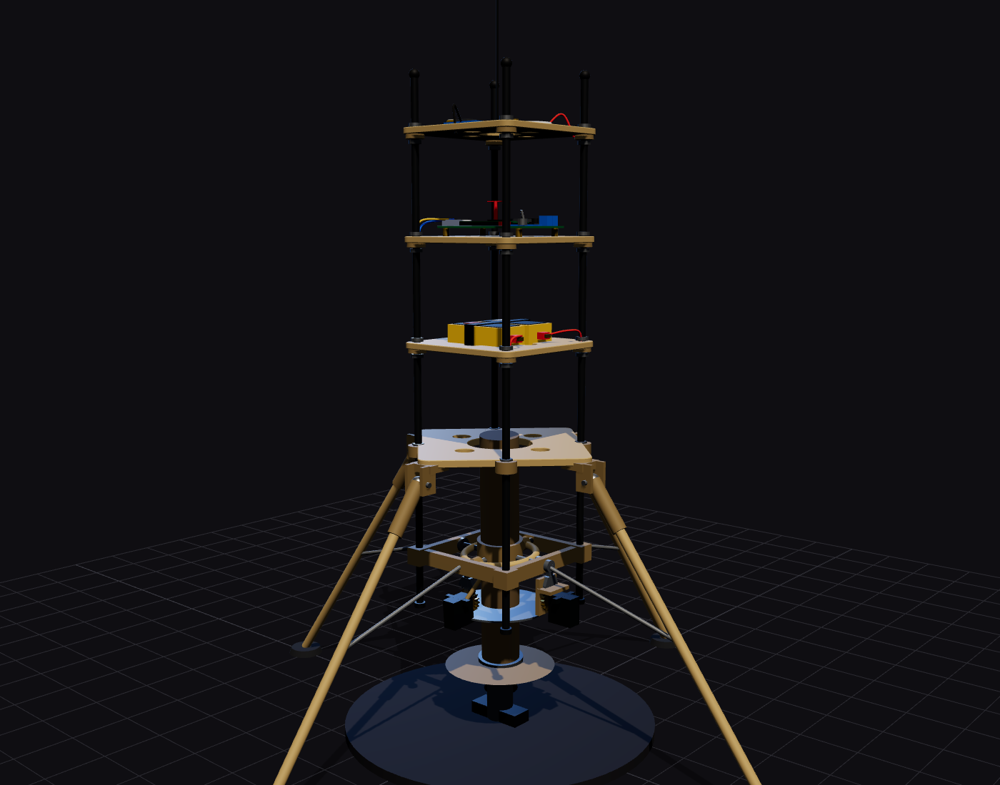
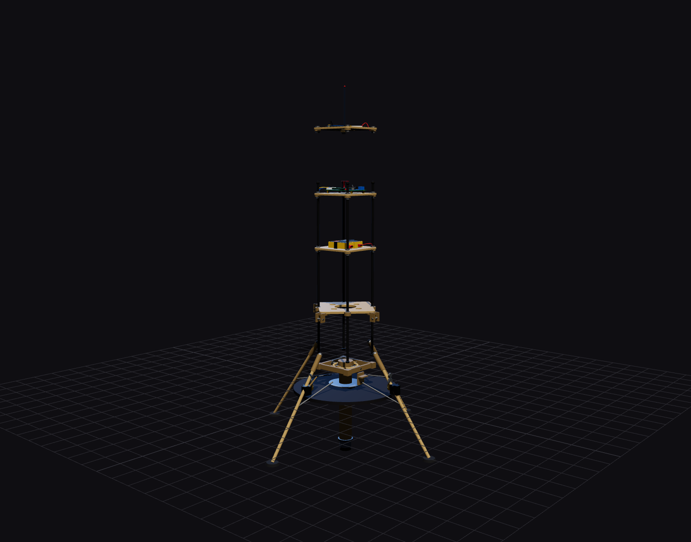
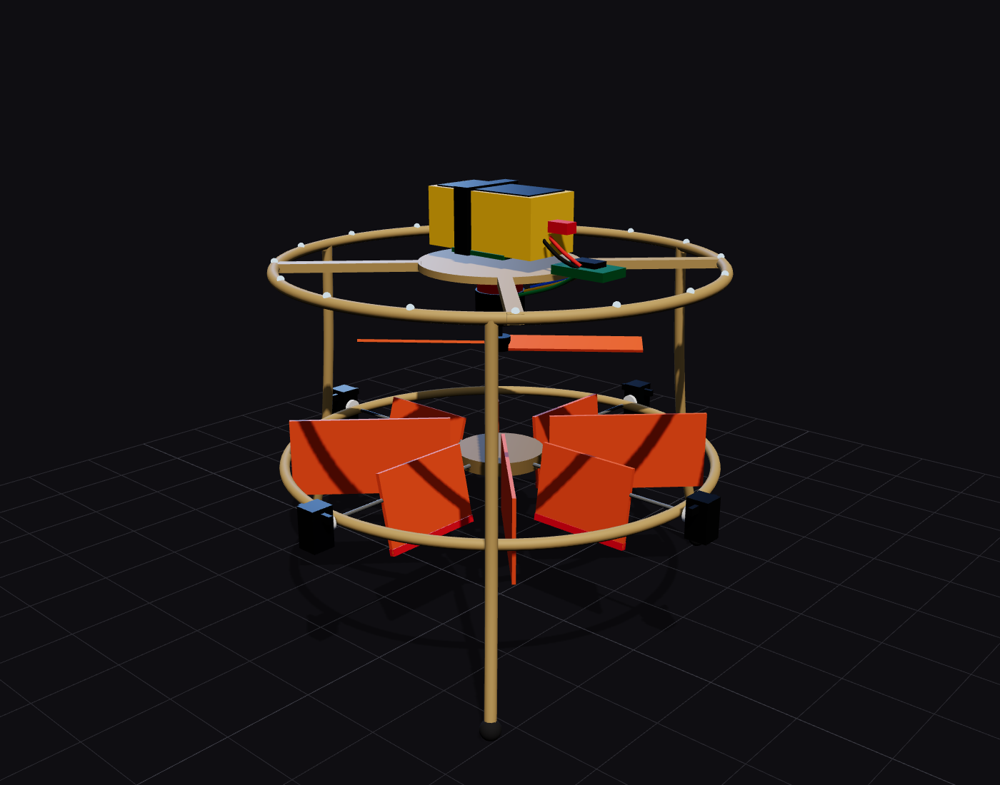

# TVC Rocket: baseline repo

A baseline for a **thrust-vector-controlled (TVC) rocket**, built in two phases.

| Phase | Vehicle | Purpose |
|---|---|---|
| **1** | **MC-1 vane-control monocopter**: one motor, one prop, four servo-driven vanes in the prop wash | Prove the flight computer, attitude estimation, control loop, actuators, logging, failsafes and operating procedures on a vehicle you can crash cheaply |
| **2** | **RK-1 TVC rocket**: stacked-frame airframe, 2-axis gear-driven gimbal, four splayed legs | The main goal. Reuses the Phase 1 electronics, software core and procedures |



<table>
<tr>
<td width="50%"><br><sub>RK-1 exploded view (generated from the same model)</sub></td>
<td width="50%"><br><sub>MC-1 monocopter with vanes deflected (Phase 1)</sub></td>
</tr>
</table>

> The 3D models are procedural three.js code (`src/models/`), driven by one parameter file (`src/data/spec.js`). They mirror the CAD browser tree of the Fusion project (`tvc`, `gear36t1`, `gear36t2`, `rods`, `landing-frame`, `battery-frame`, `pcb-frame`, `telemetry-frame`, `landing-gear`, `test-stand`). They are visualisation and teaching models, **not** manufacturing files. See [docs/cad-mapping.md](docs/cad-mapping.md).

## Quick start

Requires Node 18+ (nothing else; three.js is vendored).

```bash
npm install          # only needed for screenshots (puppeteer-core)
npm start            # http://localhost:5173
npm test             # JS unit tests (sim + mixer)
npm run test:firmware   # C++ host tests (needs g++ or clang++)
```

Open <http://localhost:5173> for the hub. Pages (all in `web/`):

| Page | What it teaches |
|---|---|
| [`rocket.html`](web/rocket.html) | Inspect every part, exploded view, live gimbal with the 2:1 gear stage, motor-burn animation |
| [`monocopter.html`](web/monocopter.html) | Inspect parts, exploded view, drive the four vanes with roll / pitch / yaw |
| [`assembly.html?model=rocket`](web/assembly.html?model=rocket) · [`?model=monocopter`](web/assembly.html?model=monocopter) | Step-by-step build wizard with the current step highlighted on the model |
| [`pid.html`](web/pid.html) | Single-axis attitude PID lab: gains, latency, actuator lag, noise |
| [`gimbal.html`](web/gimbal.html) | Thrust, lever arm, gear ratio, servo torque and resolution |
| [`sizing.html`](web/sizing.html) | Live mass budget from the BOM, thrust-to-weight, no-drag hop estimate |
| [`wiring.html`](web/wiring.html) | Block diagrams and the Teensy 4.1 pin maps |
| [`bom.html`](web/bom.html) | Searchable bill of materials with totals |

The site is static: GitHub Pages works out of the box (see `.github/workflows/pages.yml`).

## Repository map

```
README.md                 you are here
index.html                hub page (live 3D heroes + links)
web/                      interactive tutorials and viewers (HTML + ES modules)
src/
  data/spec.js            geometry and design parameters (single source of truth, mm)
  data/steps.js           build-wizard step data
  models/rocket.js        Phase 2 three.js model
  models/monocopter.js    Phase 1 three.js model
  sim/attitude.js         single-axis control simulation (PID lab + tests)
  sim/mixer.js            monocopter vane mixer (mirrors the firmware)
  common/                 stage, geometry kit, viewer app
docs/                     all documentation (start at docs/README.md)
hardware/
  bom/*.json              bill of materials (source of truth) + generated CSV
  cad/                    where the Fusion/STEP/STL files go (README explains naming)
firmware/
  lib/tvc_core/           portable C++17 core: PID, AHRS, mixers, CRSF, flight state machine
  lib/tvc_hal/            Teensy hardware drivers (ICM-42688-P)
  monocopter/             PlatformIO project, Phase 1
  rocket/                 PlatformIO project, Phase 2
  test/                   host-side unit tests (g++)
test/                     JS tests
scripts/                  serve, screenshot, BOM generator, firmware test runner
assets/screenshots/       generated by `npm run screenshots`
vendor/three/             three.js r170 (MIT), vendored so the repo works offline
```

## Documentation

Start at **[docs/README.md](docs/README.md)**. Highlights:

- [Project overview and phase gates](docs/00-project-overview.md): goals, why a monocopter first, the go / no-go gates
- [Requirements](docs/01-requirements.md) · [Architecture](docs/02-architecture.md) · [Design choices](docs/design-choices.md)
- **Phase 1:** [design](docs/phase1-monocopter/01-design.md) · [BOM](docs/phase1-monocopter/02-bom.md) · [build guide](docs/phase1-monocopter/03-build-guide.md) · [wiring](docs/phase1-monocopter/04-wiring.md) · [firmware & control](docs/phase1-monocopter/05-firmware-and-control.md) · [bench tests](docs/phase1-monocopter/06-bench-tests.md) · [tethered flight](docs/phase1-monocopter/07-tethered-flight-test.md) · [gate review](docs/phase1-monocopter/08-gate-review.md)
- **Phase 2:** [design](docs/phase2-rocket/01-design.md) · [BOM](docs/phase2-rocket/02-bom.md) · [build guide](docs/phase2-rocket/03-build-guide.md) · [wiring](docs/phase2-rocket/04-wiring.md) · [gimbal design](docs/phase2-rocket/05-gimbal-design.md) · [firmware & GNC](docs/phase2-rocket/06-firmware-and-gnc.md) · [test stand procedure](docs/phase2-rocket/07-test-stand-procedure.md) · [flight test plan](docs/phase2-rocket/08-flight-test-plan.md)
- [Safety](docs/safety.md) (read first) · [3D printing](docs/printing.md) · [Theory](docs/theory/) · [Glossary](docs/glossary.md)

## License

MIT for the code and documents in this repository (see [LICENSE](LICENSE)). three.js is MIT, vendored under `vendor/three/`.
