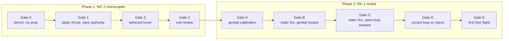

# Project overview

## Goal

Build and fly a **thrust-vector-controlled rocket (RK-1)** that holds a commanded attitude during motor burn by swivelling the motor in two axes, then lands or is recovered safely. This repository is the *baseline*: everything needed to start building and to make decisions with eyes open.

## Why a monocopter first

A TVC rocket is unforgiving. The burn is short, the motor cannot be throttled or switched off, a failed first test usually destroys the vehicle, and every iteration costs a motor. Most of the risk is **not** in the airframe but in the control stack: sensor orientation, filter behaviour, sign errors, gain tuning, actuator lag, brown-outs, logging, failsafes, and the discipline of procedures.

A **vane-controlled monocopter** (MC-1) exercises the same stack on a vehicle that:

- can be run for minutes, not seconds, with a restartable power source (a battery),
- is thrust-vectored in the same sense (vanes in the slipstream vs gimbal),
- is cheap enough to crash (≈ US$ 475 total including test gear; reusable),
- uses the **same flight computer, IMU, servo type, battery chemistry, logging and telemetry** as the rocket.

| What Phase 1 proves | Why it matters in Phase 2 |
|---|---|
| IMU mounting, axes, and sign conventions | Sign errors flip a rocket in 100 ms |
| Mahony attitude estimator on real vibration | Same filter, same noise issues |
| PID structure, loop rate, latency budget | The PID lab numbers are checked against real logs |
| Servo selection, power rail design, brown-out behaviour | Gimbal servos have the same electrical demand pattern |
| Logging and post-flight analysis workflow | You can only tune what you log |
| Failsafes: RC loss, arm interlocks, low battery | Same philosophy in the rocket's state machine |
| Operating discipline: checklists, call-outs, test director | The procedures are reused for static fires |

What Phase 1 does **not** prove: solid-motor thrust curve effects, mass change during burn, gimbal gear backlash and heat, high-g vibration, parachute recovery. Phase 2 has its own gates for those.

## Phases and gates

A gate is passed only when **all** its criteria are met **and recorded** (test log with git commit, configuration, results). The criteria are in:

- Phase 1: [06-bench-tests](phase1-monocopter/06-bench-tests.md), [07-tethered-flight-test](phase1-monocopter/07-tethered-flight-test.md), [08-gate-review](phase1-monocopter/08-gate-review.md)
- Phase 2: [05-gimbal-design](phase2-rocket/05-gimbal-design.md) (Gate A), [07-test-stand-procedure](phase2-rocket/07-test-stand-procedure.md) (B, C, D), [08-flight-test-plan](phase2-rocket/08-flight-test-plan.md) (E)

Phase 2 mechanical work (printing, gimbal, frames) can start in parallel with Phase 1. Phase 2 **powered** tests cannot start until Gate 3 is passed.

## Vehicle summaries

| | MC-1 monocopter (Phase 1) | RK-1 rocket (Phase 2) |
|---|---|---|
| Thrust source | 2306 motor + 6″ prop, 4S | 29 mm certified solid motor: F class first, G class later (baseline) |
| Control actuators | 4 vanes in prop wash, 4 servos | 2-axis gimbal, 2 servos, 2:1 gears |
| Take-off mass (BOM) | ≈ 485 g | ≈ 914 g incl. loaded motor |
| Thrust-to-weight | ≈ 3 (target ≥ 2) | ≈ 3 with an F-class motor (first tests), 6 to 13 with G-class (later) |
| Controller | Teensy 4.1, 500 Hz | Teensy 4.1, 500 Hz |
| Link | ExpressLRS (control + telemetry) | LoRa telemetry, no command uplink in flight |
| Run time | minutes (battery) | ≈ 1 to 3 s burn |
| Recovery | tether, landing legs | legs + parachute (decision D-03) |
| Attitude reference | accelerometer + gyro (no magnetometer) | same |

Numbers in the table are from the BOM JSON files and catalogue data; weigh the real parts and update.

## Deliverables of this repository

1. Models: [rocket](../web/rocket.html) and [monocopter](../web/monocopter.html) in three.js, parameterised.
2. Procedures: build guides, test procedures and gates, checklists.
3. Components: BOMs with mass and cost, wiring, pin maps.
4. Software: a portable, unit-tested core plus Teensy 4.1 projects for both vehicles.
5. Tutorials: build wizards, PID lab, gimbal lab, sizing, wiring.

## Roadmap (suggested order)

| Step | Work | Output |
|---|---|---|
| 0 | Read safety, confirm the [design choices](design-choices.md) and CAD parameters | Updated `spec.js` + BOM |
| 1 | Order Phase 1 parts, print MC-1 | Built airframe |
| 2 | Compile and bring up firmware on the bench | Gate 0 |
| 3 | Thrust stand, vane authority | Gate 1 |
| 4 | Tethered hover, tuning | Gate 2, Gate 3 |
| 5 | Print and assemble RK-1, gimbal calibration (no motor) | Gate A |
| 6 | Static fires: locked, open-loop sweeps, closed loop | Gates B to D |
| 7 | First free flight, then iterate | Gate E |

