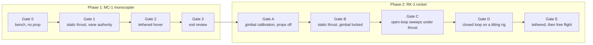

# Project overview

## Goal

Build and fly an **electric thrust-vector rocket (RK-1)**: a pair of brushless motors with propellers hangs in a two-axis gimbal, two servos steer it, and a flight computer holds the vehicle upright while the pilot flies the throttle. This repository is the baseline for it: models, procedures, components, firmware and tutorials.

## Why a monocopter first

A thrust-vectored vehicle is unforgiving. It is unstable by nature, the first wrong sign flips it in a tenth of a second, and every crash costs motors and props. Most of the risk is **not** in the airframe but in the control stack: sensor orientation, filter behaviour, sign errors, gain tuning, actuator lag, brown-outs, logging, failsafes, and the discipline of procedures.

A **vane-controlled monocopter** (MC-1) exercises the same stack on a simpler, cheaper vehicle:

- a single brushless motor and propeller, with four servo-driven vanes in the wash instead of a gimbal,
- thrust-vectored in the same sense: a side force below the CG, so roll and pitch control work the same way,
- cheap enough to crash (≈ US$ 475 total including test gear; reusable),
- the **same flight computer, IMU, servo type, receiver, logging and procedures** as the rocket.

| What Phase 1 proves | Why it matters in Phase 2 |
|---|---|
| IMU mounting, axes, and sign conventions | Sign errors flip a vehicle in 100 ms |
| Mahony attitude estimator on real vibration | Same filter, same noise issues |
| PID structure, loop rate, latency budget | The PID lab numbers are checked against real logs |
| Servo selection, power rail design, brown-out behaviour | Gimbal servos have the same electrical demand pattern |
| ESC and brushless-motor handling, prop safety | The rocket has two motors and two ESCs |
| Logging and post-flight analysis workflow | You can only tune what you log |
| Failsafes: RC loss, arm switch, interlocks | Same philosophy in the rocket's state machine |
| Operating discipline: checklists, call-outs, test director | Reused for the stand tests |

What Phase 1 does **not** prove: a mechanical gimbal with gears and backlash, a coaxial contra-rotating pair and its differential-throttle spin control, a higher thrust level and the heavier power system. Phase 2 has its own gates for those.

## Phases and gates

A gate is passed only when **all** its criteria are met **and recorded** (test log with git commit, configuration, results). The criteria are in:

- Phase 1: [06-bench-tests](phase1-monocopter/06-bench-tests.md), [07-tethered-flight-test](phase1-monocopter/07-tethered-flight-test.md), [08-gate-review](phase1-monocopter/08-gate-review.md)
- Phase 2: [05-gimbal-design](phase2-rocket/05-gimbal-design.md) (Gate A), [07-test-stand-procedure](phase2-rocket/07-test-stand-procedure.md) (B, C, D), [08-flight-test-plan](phase2-rocket/08-flight-test-plan.md) (E)

Phase 2 mechanical work (printing, gimbal, frames) can start in parallel with Phase 1. Phase 2 **powered** tests cannot start until Gate 3 is passed.

## Vehicle summaries

| | MC-1 monocopter (Phase 1) | RK-1 rocket (Phase 2) |
|---|---|---|
| Thrust source | 1 × 2306 motor + 6″ prop, 4S | 2 × 3110 motors, contra-rotating 9″ props, 6S |
| Control actuators | 4 vanes in the prop wash, 4 servos | 2-axis gimbal, 2 servos, 2:1 gears; differential throttle for spin |
| Take-off mass (BOM) | ≈ 485 g | ≈ 1.06 kg |
| Thrust-to-weight | ≈ 3 (target ≥ 2) | ≈ 2.5 (target ≥ 2) |
| Controller | Teensy 4.1, 500 Hz | Teensy 4.1, 500 Hz |
| Link | ExpressLRS | ExpressLRS |
| Run time | ≈ 5 to 8 min hover | ≈ 6 to 8 min hover |
| Recovery | tether, landing legs | tether, landing legs (propulsive landing under pilot control) |
| Attitude reference | accelerometer + gyro (no magnetometer) | same |

Numbers in the table are from the BOM JSON files and catalogue data; weigh the real parts and update.

## Deliverables of this repository

1. Models: [rocket](../web/rocket.html) and [monocopter](../web/monocopter.html) in three.js, parameterised.
2. Procedures: build guides, test procedures and gates, checklists.
3. Components: BOMs with mass and cost, wiring, pin maps.
4. Software: a portable tested core plus Teensy 4.1 projects for both vehicles.
5. Tutorials: build wizards, PID lab, gimbal lab, sizing, wiring.

## Roadmap (suggested order)

| Step | Work | Output |
|---|---|---|
| 0 | Read safety, confirm the [design choices](design-choices.md) and CAD parameters | Updated `spec.js` + BOM |
| 1 | Order Phase 1 parts, print MC-1 | Built airframe |
| 2 | Compile and bring up firmware on the bench | Gate 0 |
| 3 | Thrust stand, vane authority | Gate 1 |
| 4 | Tethered hover, tuning | Gates 2 and 3 |
| 5 | Print and assemble RK-1, gimbal calibration with props off | Gate A |
| 6 | Thrust stand: locked, open-loop sweeps, closed loop on the tilting rig | Gates B to D |
| 7 | Tethered flights, then free flights | Gate E |
