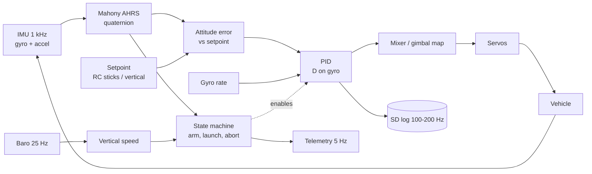
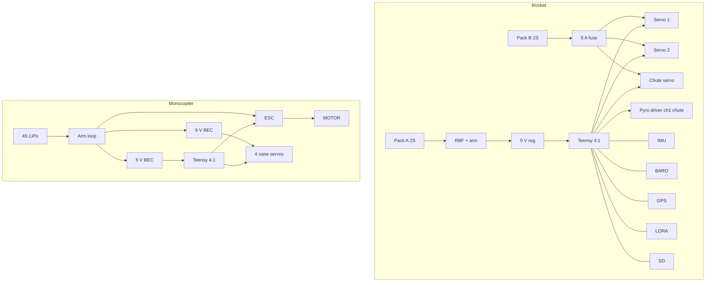

# Architecture

## 1. Shared control architecture

Both vehicles run the same software structure. Only the *plant* (what the actuators do) and the *state machine* differ.



| Layer | Monocopter | Rocket | Shared code |
|---|---|---|---|
| Estimation | Mahony, roll/pitch used, yaw rate from gyro | Mahony, nose-tilt vector | `ahrs.h` |
| Control | PID roll/pitch (angle mode), P on yaw rate | PID pitch/yaw on nose-tilt error | `pid.h` |
| Actuator map | 4-vane mixer | 2-axis gimbal, 2:1 gear map | `mixers.h` |
| Supervision | arm / failsafe on RC link | SAFE → ARMED → BOOST → COAST → DESCENT → LANDED, abort | `flight_state.h`, `crsf.h` |
| Hardware | Teensy 4.1, ICM-42688-P, ELRS | Teensy 4.1, ICM-42688-P, BMP390, GPS, LoRa | `tvc_hal/` |

The portable core is plain C++17 with no Arduino dependency, so it is unit-tested on a PC (`npm run test:firmware`). The Teensy projects only wire hardware to that core.

## 2. Mechanical architecture

### MC-1 monocopter

```
 y (mm)
 250  ┌ battery + FC stack on hub plate ┐
 205  ○───── guard ring Ø250, 4 spokes ─────○     motor under hub, shaft down
 160       prop Ø152 (pushes air down)
  92  ○───── vane deck ring + 4 vanes ───────○     4 servos on the outside of the ring
   0  legs ×3 (flexible printed)
```

Air path: prop → straighteners (orange fins on the diagonals) → vanes deflect the wash sideways → reaction forces below the CG produce roll/pitch torque, and tangential forces produce yaw torque.

### RK-1 rocket (bottom to top)

| Height (mm) | Module | CAD component |
|---|---|---|
| 0 | 4 landing legs, Ø510 mm footprint | `landing-gear` |
| 52 to 252 | Motor tube Ø32 mm, 29 mm motor | (motor) |
| 150 | Gimbal pivot; 2-axis gimbal with 36T/18T gears and 2 servos | `tvc`, `gear36t1`, `gear36t2` |
| 238 | Landing frame: diamond plate, leg hinge lugs on the corners, upper motor guide | `landing-frame` |
| 322 | Battery frame: pack A (avionics) and pack B (servos) side by side | `battery-frame1` |
| 406 | PCB frame: flight computer | `pcb-frame` |
| 490 | Telemetry frame: LoRa, GPS, antenna | `telemetry-frame` |
| 110 to 535 | 4 carbon rods Ø6 | `rods` |
| (ground) | Test stand: base, deflector, load cell | `test-stand` |

Load path under thrust: motor → tube → inner collar → pivot pins → outer ring → pivot pins → fixed mount → four rods → frames. Rods are in compression during burn; check buckling in [design](phase2-rocket/01-design.md).

Why a stacked-frame design: every module is a plate that can be built, wired and tested on the bench independently, and exchanged. Servo power and logic power are separated physically as well as electrically (two battery frames).

## 3. Electrical architecture



Detailed diagrams and pin maps: [web/wiring.html](../web/wiring.html), [phase 1 wiring](phase1-monocopter/04-wiring.md), [phase 2 wiring](phase2-rocket/04-wiring.md).

Design rules: one ground star point; servo rail never shares a regulator with the logic rail; every high-current path is soldered; connectors are locking; all pyro outputs default LOW with 10 kΩ pull-downs and are disabled by hardware until the RBF pin is removed.

## 4. Data architecture

| Data | Producer | Rate | Store |
|---|---|---|---|
| Raw gyro/accel | IMU | 1 kHz sampled at 500 Hz | not stored (derived) |
| Attitude, rates, commands, states, battery | Flight loop | 100-200 Hz | SD CSV (`flight.csv`) |
| Telemetry line `$TVC,ms,state,tilt,alt,vz` | Rocket | 5 Hz | LoRa → ground station |
| BOM | `hardware/bom/*.json` | on change | repo |
| Test logs | Humans | per test | `docs/test-logs/` |

Analysis workflow: copy `flight.csv` into `logs/` (git-ignored), plot with any tool, compare against the [PID lab](../web/pid.html) prediction, record conclusions in a test log.

## 5. Software repository architecture

```
spec.js  ──► models (three.js)  ──► viewers, wizards, screenshots
BOM json ──► gen-bom.mjs        ──► CSV, docs BOM tables, sizing page
mixers.h ◄──► mixer.js           (identical behaviour, tested on both sides)
attitude.js presets ──► firmware gains (kept equal by hand, see CONTRIBUTING)
```
