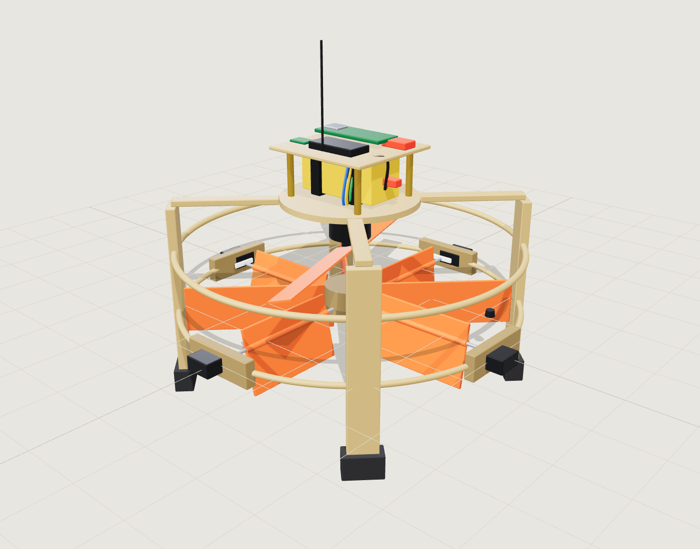

# Phase 1 design: MC-1 vane-control monocopter

Interactive: [web/monocopter.html](../../web/monocopter.html) · printable parts: [web/parts.html](../../web/parts.html) · exploded: [monocopter-exploded.png](../../assets/screenshots/monocopter-exploded.png)

## 1. Concept

One brushless motor drives one **10 inch propeller** that pushes air **down**. Below the propeller sit four servo-driven **vanes** in the slipstream. Deflecting a vane pushes the wash sideways and produces an equal and opposite side force on the airframe. Because the vanes are below the centre of gravity (CG), that force tilts the vehicle: opposite pairs give roll and pitch, all four together give yaw.

Four fixed **stator fins** (the orange fins on the diagonals) sit in the same flow. A propeller leaves the air rotating; stationary fins remove that rotation and the airframe receives the opposite torque. This cancels a large part of the prop reaction torque, so the vanes keep their authority for control instead of spending it on holding the heading.

MC-1 is the **experimental vehicle**. The rocket is the main goal; the monocopter exists to learn the parts the rocket shares with it: the propulsion stack (motor, ESC, prop, 4S power), servos and their power, the wireless link, arming and failsafes, vane/gimbal-style side-force control, and tethered operations.

## 2. Control concept: ESP32, no IMU

The only controller is an **ESP32-S3**. It makes its own Wi-Fi network, serves a web page to a phone, and writes one ESC signal and four servo signals. There is **no radio receiver, no gyro, no accelerometer and no attitude estimate**.

* The pilot commands throttle, a direction (the wheel on the phone) and yaw. The firmware ([`phone_mode.h`](../../firmware/lib/tvc_core/phone_mode.h)) ramps the throttle, applies a wheel curve, a vane scale that follows throttle, the vane mixer, the arming rules and the failsafe. See the [phone control guide](09-phone-control.md).
* The pilot (and the tether) close the attitude loop. The thrust line passes through the CG, so the vehicle has **no restoring torque**: a tilt stays until it is corrected. Fly it tethered, keep the lines slightly slack, and correct with small wheel inputs.
* This is intentional. It keeps Phase 1 cheap and simple and teaches the vane side-force behaviour with the parts the rocket will use. It is **not** a hands-off hover vehicle. If you later want stabilisation, add an IMU and the control loop from the rocket firmware ([firmware README](../../firmware/README.md)).

## 3. Geometry (from `src/data/spec.js`)

Coordinates: z up, origin on the prop axis at the height of the vane hinge axes.

| Item | Value |
|---|---|
| Propeller | 10 × 4.5 two-blade **pusher**, Ø254 mm, plane at z = 52 mm |
| Motor | 28xx outrunner hanging under the hub plate, shaft down, z 60 to 90 mm |
| Posts (also the legs) | 4 on the diagonals at r = 145 mm, 12 × 24 mm section, z −75 to +90 mm |
| Prop guard ring | r = 145 mm at z = 52 mm: **13 mm** outside the prop tips (inner edge at r = 140) |
| Vanes | 4 on the axes, 91 (span) × 55 (chord) × 2.6 mm, r = 30 to 121 mm, hinge 30 % back, ±25° |
| Stator fins | 4 on the diagonals, 40 mm tall, 3.0 mm thick, r = 14 to 135 mm |
| Lower hub | Ø44 mm under the prop, carries the four Ø3 vane rods and the stators |
| Hub plate | Ø116 mm at z 90 to 95 mm: motor underneath, battery on top |
| Electronics deck | 96 × 88 mm at z 134 to 137 mm on four 39 mm standoffs, in the prop intake airflow |
| Battery | 4S 1500 mAh, 75 × 35 × 34 mm, strapped on the hub plate |
| Overall | Ø310 mm footprint (post feet) × 220 mm tall |

## 4. Why a 10 inch prop

| | 6″ prop (earlier baseline) | 10″ prop |
|---|---|---|
| Disc area | 0.0181 m² | 0.0507 m² |
| Hover power for the same 892 g (momentum theory, FM 0.55, η 0.8) | ≈ 280 W (19 A) | ≈ 170 W (11.5 A) |
| Wash speed at hover (2 × induced velocity) | ≈ 28 m/s in a narrow jet | ≈ 17 m/s over a wide one |
| Room for vanes | 62 mm span | 91 mm span |

A bigger disc moves more air more slowly, which is much more efficient and gives the vanes more area. The price is a Ø316 mm vehicle and a stronger frame. **Recommendation: 10″ as designed.** A 9″ or 8″ prop also works: reduce `prop.radius`, `postRadius` and the vane span in `src/data/spec.js` and `scripts/cad/mono.mjs`, then run `npm run cad`.

Do not go below 8″ with this vane layout: the wash is too narrow for the vanes. Do not use a three-blade prop first: the two-blade prop is more efficient and easier to balance.

## 5. Propulsion and power sizing (design values)

Momentum theory, `P = T^1.5 / (sqrt(2 ρ A) · FM · η)`, ρ = 1.225 kg/m³, A = 0.0507 m², figure of merit 0.55, motor + ESC efficiency 0.8:

| Condition | Thrust | Electrical power | Current at 14.8 V |
|---|---|---|---|
| Hover, 892 g (8.8 N) | 8.8 N | ≈ 170 W | ≈ 11.5 A |
| Thrust-to-weight 2 (17.5 N) | 17.5 N | ≈ 470 W | ≈ 32 A |

* **Motor.** A 28xx outrunner, about **1100 KV**, rated 40 A on 4S (for example a 2810). Do not choose a high-KV (> 1500 KV) motor: it cannot turn a 10″ prop efficiently on 4S.
* **ESC.** 40 A, 4S, BLHeli_S or AM32, driven by a standard 400 Hz PWM signal (1000 to 2000 µs).
* **Battery.** 4S 1500 mAh, 75C, XT60: about 175 g. Hover endurance ≈ 6 minutes at 80 % usable capacity. A 2200 mAh pack gives ≈ 9 minutes for +55 g; it must still fit 75 × 35 × 35 mm between the strap slots.
* **Check at Gate 1:** static thrust must reach **17.5 N (about 1.8 kgf)** at ≤ 80 % throttle. If your motor/prop pair cannot, choose a lower-KV motor or a higher-pitch prop before flying.

## 6. Vane physics (design values)

**Wash speed.** `v = sqrt(T / (2 ρ A))`. The wash behind the prop is about twice the induced velocity.

| Condition | Thrust | Wash speed | Dynamic pressure q |
|---|---|---|---|
| Hover (892 g) | 8.8 N | ≈ 17 m/s | ≈ 165 Pa |
| Design maximum | 17 N | ≈ 23 m/s | ≈ 335 Pa |

**Vane force.** `F = q · S · C_L`, vane area `S = 0.091 × 0.055 = 5.0 × 10⁻³ m²`, flat-plate `C_L` ≈ 1.0 at 25°.

| Condition | Force per vane at 25° |
|---|---|
| Hover | ≈ 0.8 N |
| Maximum throttle | ≈ 1.7 N |

**Roll / pitch authority.** The CG is about **53 mm above the vane hinge axes** (from the parts-list masses and the CAD heights), that is close to the prop plane. Two opposed vanes give `τ = 2 F h = 2 × 0.8 × 0.053 ≈ 0.085 N·m` at hover. With roll inertia `I ≈ 0.005 kg·m²` that is an angular acceleration of about 17 rad/s² (≈ 1000°/s²). This is strong: the sticks are scaled to 60 % of the vane travel by default.

**Yaw.** At hover the prop shaft power is about 135 W at about 7500 rpm, so the reaction torque is about 0.17 N·m. The stator fins recover a large part of it. The yaw authority of the vanes is `r̄ Σ F ≈ 0.0755 × 4 × 0.8 ≈ 0.24 N·m`. Requirement MC-04: the residual torque must be at most 60 % of the vane yaw authority. Without stators it would be about 70 %, so the stators matter; Gate 1 measures the real number and sets `yawTrim`.

**The vane force grows with the wash** (≈ thrust), so the firmware scales the wheel commands by `hoverThrottle / throttle` (limited to 0.6 to 1.6).

## 7. Mass and CG (from the parts list)

Generated from [`hardware/bom/monocopter.json`](../../hardware/bom/monocopter.json); see also the [sizing page](../../web/sizing.html?model=monocopter).

| Group | Mass |
|---|---|
| Battery 4S 1500 | 175 g |
| Printed structure (65 % of the 688 g solid mass of the 40 mounted pieces) | 447 g |
| Servos ×4 + vane rods | 76 g |
| Motor + prop + ESC | 83 g |
| BECs, power leads, switch, wiring | 52 g |
| ESP32-S3, buzzer, LEDs | 15 g |
| Screws, nuts, inserts, standoffs, strap | 43 g |
| **Total on-board** | **≈ 892 g** |

Target: ≤ 950 g (MC-01). The printed parts dominate: use the baseline settings, weigh the real parts and update the parts list. The CG sits on the axis (the battery, motor and deck are all centred) and about 53 mm above the vane axes; check it with the hang test in the build guide.

## 8. Structure: how it holds together

| Load | Path |
|---|---|
| Thrust (8 to 17 N) | prop → motor → hub plate → four arms → four posts → the ground through the feet |
| Landing shock | feet (TPU caps) → posts → arms. The posts are 12 × 24 mm PETG in bending and the arms T-sections with an 11 mm rib; keep landing speeds under 2 m/s |
| Vane forces (≤ 2 N each) | vane → rod → hub (inner end) and servo (outer end) → cradle → half-arcs → posts |
| Wash torque reaction | stators → posts |

The posts, the lower ring and the guard ring form three rigid hoops (the arms at the top, the lower ring at the vanes, the guard ring at the prop). The design is checked for interference by `npm run cad:assembly`: 58 solids, including the motor, prop disc, battery, servos, horns and rods, with the vanes at full deflection in nine combinations, and an installation pose for each vane.

## 9. Why these design choices

| Choice | Reason | Alternative |
|---|---|---|
| Prop under the motor (pushes down) | The wash passes through the vanes; the electronics sit in the clean intake airflow (cooling) | Prop on top, vanes under the prop: more drag on the wash |
| 4 vanes in X + 4 fixed stators | 2 vanes per axis, simple mixer, stators cancel prop torque | 3 vanes: coupled axes |
| Direct-drive servos (no linkage) | No slop, fewer parts, vane angle = servo angle | Pushrods: easier alignment, backlash |
| 9 to 12 g digital metal-gear servos | Cheap, fast, ample torque (vane hinge torque < 0.05 N·m) | Standard servos: heavier |
| ESP32-S3, no IMU | Cheap, simple, one board; Phase 1 is about the vane side-force and the power system | Teensy 4.1 + IMU if you want stabilisation |
| Four posts that are also legs | One strong member carries thrust, landing and both rings | Separate legs: heavier |
| PETG structure, TPU feet | Light, cheap, repairable, tolerant of vibration | PA-CF: stiffer, for the second set |
| Phone over Wi-Fi (the ESP32-S3 is the access point) | Nothing to buy or bind, a real display with live vane angles, smooth throttle ramps and a direction wheel; enough range for a tethered experiment | An ExpressLRS receiver and a radio (the rocket's link) for range and lower latency |

## 10. Risks

| Risk | Mitigation |
|---|---|
| Not enough thrust | Measure at Gate 1. Fallbacks: lower-KV motor, higher-pitch prop, 5S pack with a 5S-rated motor and ESC |
| Not enough vane authority | Measure at Gate 1. Fallbacks: raise `rollScale`/`pitchScale`, larger vanes, move the vanes closer to the prop |
| Prop torque exceeds yaw authority | Check with vanes centred on the stand; `yawTrim`; stators |
| Tipping or drifting in free flight (no IMU) | Fly tethered only; keep the lines slightly slack |
| Servo brown-out | Separate 6 V BEC, brown-out test in the bench tests |
| Wrong vane order or sign | Mandatory sign checks at Gate 0 |
| Wrong prop type | The prop must be a pusher (reverse-pitch) type for the motor direction: check it on the stand with a strip of paper before flight |
| Prop strike | Guard ring, shield, tether, props off for all bench work |
| Battery fire | LiPo rules in [safety](../safety.md) |

## 11. What to measure at Gate 1 (feeds back into this document)

| Quantity | How | Update |
|---|---|---|
| Static thrust vs throttle | Load cell stand | Sizing page, requirement MC-02, `hoverThrottle` |
| Vane force vs deflection and throttle | Vehicle pivoted on the stand; torque arm and scale | Authority numbers in §6, `rollScale`, `pitchScale` |
| Residual yaw torque | Vanes centred, torque arm | MC-04, `yawTrim` |
| CG height and roll inertia | Hang test, bifilar pendulum | Design numbers in §6 and §7 |
| Battery sag under load | Log voltage | Thrust curve at hover |
