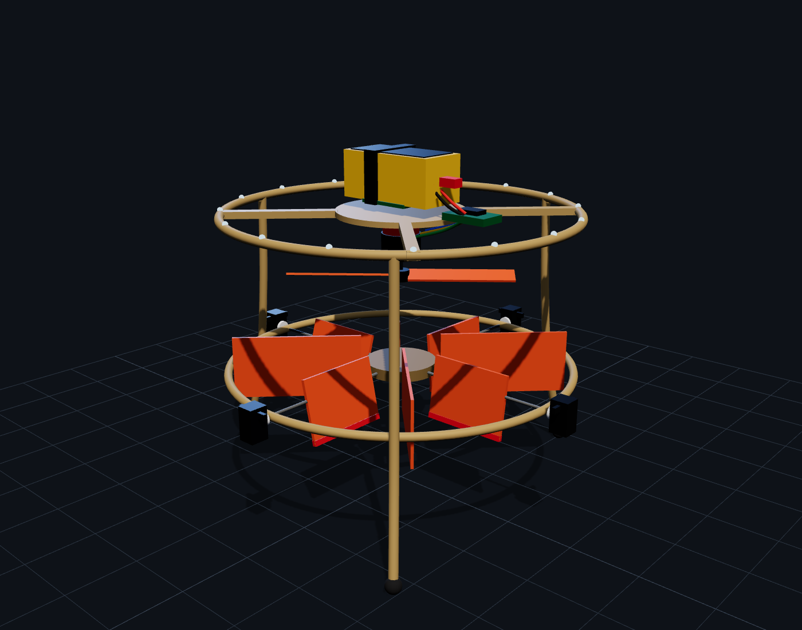

# Phase 1 design: MC-1 vane-control monocopter

Interactive: [web/monocopter.html](../../web/monocopter.html) · exploded: [monocopter-exploded.png](../../assets/screenshots/monocopter-exploded.png)

## 1. Concept

One brushless motor drives one propeller that pushes air **down**. Below the propeller sit four servo-driven **vanes** in the slipstream. Deflecting a vane pushes the wash sideways and produces an equal and opposite side force on the airframe. Because the vanes are well below the centre of gravity (CG), side forces make roll and pitch torques. Forces in a common tangential direction make yaw torque.

There is no swashplate, no tail rotor and no multiple motors. The only things that move are one motor and four small servos, so the control problem is the same as a TVC rocket: **a single thrust source whose direction is changed by a small actuator**.

Radial **swirl-straightening fins** (the orange fins on the diagonals) sit in the same flow. A propeller leaves the air rotating; stationary fins remove that rotation and the airframe receives the opposite torque. This cancels most of the prop reaction torque, leaving the vane yaw command to trim the remainder.

## 2. Geometry (from `src/data/spec.js`)

| Item | Value |
|---|---|
| Guard ring | Ø250 mm, tube Ø6.4 mm, at 205 mm above the ground |
| Vane deck | Ø250 mm ring at 92 mm |
| Propeller | 6″ (152 mm), at 160 mm; motor above it at 182 mm, shaft pointing down |
| Vanes | 4 × 62 (span) × 46 (chord) × 2.4 mm, hinge radius 32 to 94 mm, ±25° |
| Straightening fins | 4 diagonal fins, 46 mm tall |
| Legs | 3 legs, foot circle Ø300 mm |
| Battery | 4S 1300 mAh on top of the hub, 75 × 33 × 36 mm |
| Overall | Ø300 mm foot circle × ≈ 250 mm height |

## 3. Vane physics (design estimate)

Everything below is **an estimate with ±50 % uncertainty**. Gate 1 measures the real values. Use these numbers for sizing and for the starting PID gains, not as promises.

**Wash speed.** Momentum theory: `v = sqrt(T / (2 ρ A))` with disk area `A = π (0.076)² = 0.0181 m²`, ρ = 1.2 kg/m³.

| Condition | Thrust | Wash speed | Dynamic pressure q |
|---|---|---|---|
| Hover (485 g) | 4.76 N | ≈ 10.5 m/s | ≈ 66 Pa |
| Max (design) | 14 N | ≈ 18 m/s | ≈ 190 Pa |

**Vane force.** A vane's side force is `F = q · S_eff · C_L`. The part of each vane inside the wash disk is `S_eff ≈ 0.044 × 0.046 = 0.002 m²`; flat-plate `C_L` near 25° deflection is about 1.0.

| Condition | Force per vane |
|---|---|
| Hover | ≈ 0.13 N |
| Max throttle | ≈ 0.38 N |

**Roll / pitch authority.** The CG is about 177 mm above the ground (BOM masses). The vane plane is at 92 mm, so the lever `h ≈ 85 mm`. Two opposed vanes give `τ = 2 F h = 2 × 0.13 × 0.085 ≈ 0.022 N·m` at hover. With roll inertia `I ≈ 0.003 kg·m²` (estimated from the BOM masses and positions) the authority is `α = τ / I ≈ 7 to 9 rad/s²` for full vane deflection, which the control simulation uses as `G ≈ 9`.

**Meaning:** at hover, full vane deflection can accelerate the vehicle angularly at about 500°/s². That is plenty for stabilisation in calm air, but it is **not generous**. It means:

- tuning must be gentle, the loop is slower than on a quadrotor (the PID lab preset has `ωn ≈ 5 rad/s`),
- more throttle gives more authority (authority scales with thrust),
- bigger vanes, a larger prop, or a longer lever would all help. They are the first things to change if Gate 1 shows less authority than required.

**Yaw / prop reaction torque.** At hover the prop absorbs roughly 80 W at about 11 000 rpm, giving a reaction torque of ≈ 0.07 N·m. The straighteners recover most of it; the vanes' yaw authority is `r Σ F ≈ 0.06 × 4 × 0.13 ≈ 0.03 N·m` at hover. Requirement MC-04 therefore demands that the *residual* torque (after straighteners) is at most 60 % of the vane yaw authority. If the residual is too large the vehicle will spin up: add more straightening area (more or taller fins) before anything else.

## 4. Mass budget (from the BOM)

Generated from [`hardware/bom/monocopter.json`](../../hardware/bom/monocopter.json); see also the [sizing page](../../web/sizing.html?model=monocopter).

| Group | Mass |
|---|---|
| Battery 4S 1300 | 155 g |
| Printed structure + hardware | ≈ 125 g |
| Servos ×4 + hinge shafts | ≈ 64 g |
| Motor + prop + ESC | ≈ 49 g |
| Power electronics, wiring | ≈ 56 g |
| Avionics (FC, IMU, baro, RX, SD, LEDs) | ≈ 38 g |
| **Total on-board** | **≈ 485 g** |

Target: ≤ 550 g (MC-01). A 2306 motor with a 6×3.5 prop on 4S usually gives 1.2 to 1.6 kgf of static thrust (verify). With 14 N, TWR = 2.9. Requirement: ≥ 2.0.

## 5. Why these design choices

| Choice | Reason | Alternative |
|---|---|---|
| Prop under the motor (pushes down) | The wash passes through the vanes; the motor and electronics stay in clean air | Prop on top, vanes under the prop: more drag on the wash, similar result |
| 4 vanes in X | 2 vanes per axis, symmetric, simple mixer, redundancy | 3 vanes: less hardware, coupled axes |
| Digital micro servos (9-13 g) | Cheap, fast (≈ 0.1 s/60°), ample torque for vanes (forces are < 1 N) | Standard servos: heavier |
| Teensy 4.1 | Same as the rocket | Any 100 MHz+ MCU |
| Angle mode with PID | Easy to fly tethered | Rate mode (acro): harder to learn |
| Printed ring (PETG) | Light, cheap, repairable | Carbon ring: stiffer, more expensive |
| ELRS receiver | Low latency, telemetry back-channel | Any RC link with SBUS/CRSF |
| No magnetometer | Yaw drift is irrelevant for stabilisation. Same as the rocket | Add one if you want a compass-hold mode |

## 6. Risks

| Risk | Mitigation |
|---|---|
| Not enough vane authority | Measure at Gate 1. Fallbacks: larger vanes, 7″ prop, move the vane deck lower |
| Prop torque exceeds yaw authority | Add straightening fins; check by static test with vanes centred |
| Vibration corrupts the IMU | Foam mounting, balanced prop, gyro low-pass, check in the bench test with the motor spinning |
| Servo brown-out | Separate 6 V BEC, check current at stall, brown-out test in bench tests |
| Wrong vane order or sign | Mandatory sign checks at Gate 0 |
| Prop strike | Guard ring, shield, tether, props off for all bench work |
| Battery fire | LiPo rules in [safety](../safety.md) |

## 7. What to measure at Gate 1 (feeds back into this document)

| Quantity | How | Update |
|---|---|---|
| Static thrust vs throttle | Load cell stand | Sizing page, requirement MC-02 |
| Vane force vs deflection and throttle | Vane-only deflection with the vehicle pivoted on the stand; torque arm and scale | `G` in the PID lab and firmware gains |
| Residual yaw torque | Vanes centred, torque arm | MC-04 |
| CG height and roll inertia | Hang test, bifilar pendulum | Design numbers in §3 |
| Battery sag under load | Log voltage | Thrust curve at hover |
