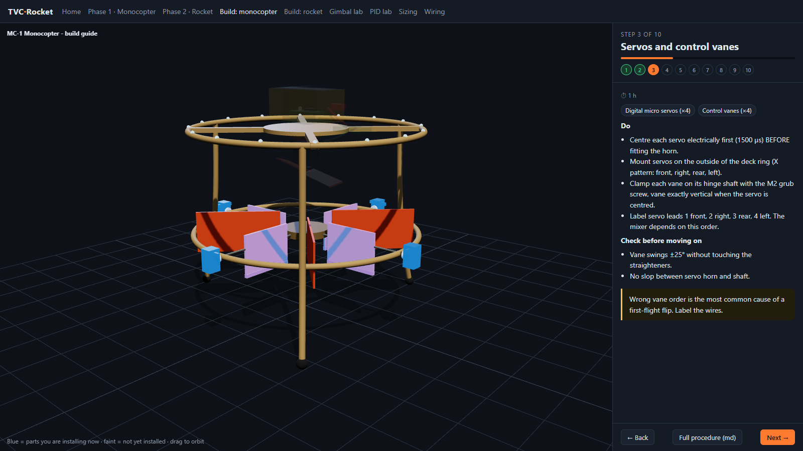

# Phase 1 build guide: MC-1 monocopter

Interactive version with the current step highlighted on the 3D model: **[web/assembly.html?model=monocopter](../../web/assembly.html?model=monocopter)**. This document has the long form and the checks.



**Before you start:** read [safety](../safety.md). Order parts from the [BOM](02-bom.md). Tools: hobby soldering iron (and a heat-set insert tip), hex drivers 1.5/2/2.5 mm, small side cutters, calipers, multimeter, hot-air gun or lighter for heat-shrink, kitchen scale (0.1 g), prop balancer, 3 A current-limited bench supply (or smoke stopper), laptop with PlatformIO.

Time budget: print ≈ 10 h, build ≈ 8 h, bench tests ≈ 4 h.

---

## Step 1: Print and prepare the structure

| Do | Check |
|---|---|
| Print the parts in the [printing guide](../printing.md) (PETG, 0.2 mm, 4 perimeters, 30 % gyroid; vanes 100 %) | Part weights are within 10 % of the BOM |
| Remove supports, deburr every hole with a 3 mm drill turned by hand | M3 screw enters each hole freely |
| Install M3 brass heat-set inserts in the hub plate (motor mount ×4, FC standoffs ×4), deck ring (servo mounts) and ring (leg mounts), iron at ≈ 220 °C, press straight until flush | Inserts flush and square, no melted blobs inside the thread |
| Dry-fit the ring segments (if split) with M3 and pins | Ring lies flat on a table (≤ 1 mm warp) |

## Step 2: Legs and vane deck

1. Fix the three legs to the guard ring at 120° spacing (the model puts them at 50°, 170°, 290° so they clear the servo positions). Fit the rubber foot caps.
2. Mount the vane deck ring 113 mm below the guard ring using the leg brackets (deck at 92 mm, guard ring at 205 mm above the ground plane).
3. Press the four Ø2 mm steel hinge shafts (110 mm long) through the deck: each shaft passes through the centre hub and the ring.

**Check:** shafts spin freely under a fingertip; shafts are coplanar (use a flat table as reference); frame stands level on its three feet (< 2 mm).

## Step 3: Servos and control vanes

1. **Centre each servo electrically first**: connect to the servo tester or flight computer at 1500 µs. Fit the horn so it points exactly radial/vertical per the CAD. Do not centre by feel.
2. Mount each servo on the **outside** of the deck ring (X pattern: **front, right, rear, left**). M2 screws into the inserts.
3. Clamp each vane on its hinge shaft with an M2 grub screw so the vane plate is vertical when the servo is centred (use a small square).
4. Connect the servo horn to the hinge shaft end so that servo rotation = vane rotation 1:1 (direct drive).
5. **Label every servo lead:** `V1 front`, `V2 right`, `V3 rear`, `V4 left`. The mixer relies on this order.

**Check:** vane swings ±25° without hitting the fins; no slop between horn and shaft; no binding; all four vanes are the same angle when centred.

> **Why the label:** a wrong vane order or mirrored servo is the most common cause of a first-flight flip. The bench sign checks in [06-bench-tests](06-bench-tests.md) catch it, but labelling prevents it.

## Step 4: Motor and propeller (propeller stays OFF)

1. Mount the 2306 motor under the hub plate, shaft **down**, with M3 screws (short! see motor datasheet for maximum screw length) and thread-lock.
2. Spin the bell by hand: no rubbing, no wobble.
3. Do **not** fit the propeller yet. Put it in a labelled bag.
4. Balance the propeller on a balancer: remove material from the heavy blade (light sanding of the back face), or add a small piece of tape to the light one, until it stays horizontal.

**Check:** motor wires routed away from the bell; screws do not touch the windings (spin test).

## Step 5: ESC, power wiring and battery tray

1. Solder the XT60 lead (14 AWG silicone) to the ESC power pads, with a 1000 µF 35 V low-ESR capacitor across the pads as close as possible. Insulate with heat-shrink.
2. Connect three motor wires to the ESC (any order). Direction is fixed later in the ESC configurator.
3. Install the **arming loop** (XT30 pair or anti-spark switch) in series with the battery positive lead.
4. Solder the two BECs to the arming-loop side of the supply: 6 V / 5 A for servos, 5 V / 3 A for logic. Heat-shrink everything.
5. Mount the ESC on its pad on the spoke (Velcro + zip tie).

**Check (no battery):** with a multimeter, battery+ to battery− reads open; no continuity from battery− to either BEC output; BEC outputs to ground are open.

**Check (current-limited supply, 12 V, 2 A limit):** insert the arming loop. Idle current < 100 mA, BEC outputs read 5.0 ± 0.1 V and 6.0 ± 0.1 V. Remove the loop.

## Step 6: Flight-computer stack

1. Solder female headers to the carrier board for the Teensy 4.1. Solder the IMU, barometer, INA226 and receiver headers per the pin map in [04-wiring](04-wiring.md).
2. Install the Teensy last. Do not plug USB while the battery is connected.
3. Mount the carrier on four M3 nylon standoffs with silicone grommets (vibration isolation). Orient the board so that the **IMU X axis points to the front (vane 1)** and the IMU Z axis points **down** (ICM-42688 pad marking: check the board silk, then confirm in the sign test).
4. Wire the servo signals to pins 3, 4, 5, 6 in order V1, V2, V3, V4. ESC signal to pin 2. Servo power to the 6 V rail. Join grounds at the carrier board only.
5. Route the receiver antenna along the ring, away from the motor wires.

**Check:** continuity of every signal wire to its pin; no short between 5 V and 6 V rails; the IMU board sits horizontally and is **at or very near the vertical axis through the CG**.

## Step 7: Battery, strap, CG

1. Fit the 4S pack on top of the stack with Velcro strap and foam.
2. Hang the vehicle on two strings at the hub plate (or balance it on a rod across the ring at the hub). Slide the battery fore/aft until the vehicle hangs level.
3. Weigh the finished vehicle without the propeller: update the BOM if it is more than 5 % off.

**Check:** CG within ±3 mm of the vertical thrust axis; the battery cannot move under a 3 g shake (shake test by hand).

## Step 8: Firmware flash

```bash
cd firmware/monocopter
pio run -t upload
pio device monitor
```

Expected: gyro-calibration message, then console lines `armed=0 rc=0 roll=... pitch=... thr=...` at 10 Hz. A fast-blinking LED means the IMU was not found (check wiring and chip select). Continue with [05-firmware-and-control](05-firmware-and-control.md) and [06-bench-tests](06-bench-tests.md).

## Step 9: ESC and receiver set-up (still no propeller)

1. ESC: connect to the ESC configurator with a programmer or passthrough; set motor direction, enable PWM input at 400 Hz-compatible mode, set low throttle calibration (1000 µs = stop, 2000 µs = full).
2. Receiver: bind the ELRS receiver; set channels AETR; AUX1 (channel 5) as the arm switch; a **throttle-cut** switch on AUX2 as a second kill (optional but recommended).
3. Verify channel values on the serial console with the transmitter sticks.

## Step 10: Gates

Proceed to the bench tests: Gate 0, then Gate 1 (propeller fitted for the first time **on the stand**), then Gate 2 (tethered hover).

## Troubleshooting

| Symptom | Likely cause |
|---|---|
| Fast LED blink on boot | IMU not detected: check CS pin 10, SPI wiring, 3.3 V |
| `rc=0` always | Receiver not bound, TX/RX swapped, wrong baud (CRSF 420000) |
| Servos twitch or reset the Teensy | Servo rail shares the logic regulator, ground loop, weak BEC |
| Roll angle drifts slowly | Gyro not calibrated at rest; vibration; loosen mount |
| Motor will not arm | Throttle > 5 % at arm time, tilt > 20°, or arm switch not above 1700 µs |
| One vane moves the wrong way | Servo mirrored: set `VANE_SIGN[i] = -1` after confirming with the sign test |
