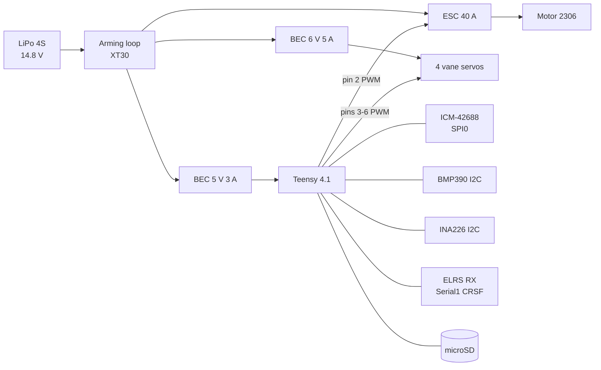

# Phase 1 wiring: MC-1 monocopter

Interactive block diagram: [web/wiring.html](../../web/wiring.html). Pin map source of truth: [`firmware/monocopter/include/pins.h`](../../firmware/monocopter/include/pins.h).

## Pin map (Teensy 4.1)

| Pin | Function | Connected to | Notes |
|---|---|---|---|
| 10 | SPI0 CS | ICM-42688-P CS | |
| 11 / 12 / 13 | SPI0 MOSI / MISO / SCK | ICM-42688-P | Keep wires < 5 cm |
| 9 | IMU INT | ICM-42688-P INT1 | Not used by the baseline loop (polling) |
| 18 / 19 | I²C SDA / SCL | BMP390 (0x76), INA226 (0x40) | 4.7 k pull-ups on the carrier |
| 0 / 1 | Serial1 RX / TX | ELRS receiver TX / RX | 420 000 baud, 3.3 V logic |
| 2 | ESC signal | ESC | 400 Hz PWM, 1000 to 2000 µs. DShot is a later upgrade |
| 3 / 4 / 5 / 6 | Vane servo 1 front, 2 right, 3 rear, 4 left | Servo signal | 50 Hz, 900 to 2100 µs |
| 7 | Buzzer | Active buzzer via NPN | |
| 8 | Status LED | LED + 330 Ω | On when armed |
| SDIO | microSD | on-board slot | Log file `flight.csv` |
| VIN, GND | 5 V in | Logic BEC | **Do not** also power from USB while the battery is connected |

## Power tree

| Rail | Source | Loads | Notes |
|---|---|---|---|
| 14.8 V | LiPo via arming loop | ESC, BEC 6 V, BEC 5 V | Fuse optional; arming loop is the isolation |
| 6.0 V | BEC 5 A | 4 servos | ≈ 0.1 A idle, up to 3 to 4 A stall |
| 5.0 V | BEC 3 A | Teensy, IMU 3.3 V (via Teensy regulator), receiver, buzzer, INA226 | Keep clean: low-ESR cap 100 µF at the carrier |

Ground: all grounds join at **one point** on the carrier board. Servo ground returns directly to the 6 V BEC ground, not through the carrier tracks.

## Wire gauges and connectors

| Path | Wire | Connector |
|---|---|---|
| Battery → arming loop → ESC | 14 AWG silicone | XT60 (battery), XT30 loop |
| ESC → motor | motor leads (as supplied) | bullet connectors or solder |
| BEC outputs | 22 AWG | JST-XH or soldered |
| Servo leads | as supplied; extend with 26 AWG | JST/servo 3-pin; use heat-shrunk joints |
| Signals | 26–30 AWG silicone | pin headers with hot-glue strain relief |

## Harness rules

1. Twist the battery and motor leads. Keep them ≥ 20 mm from the IMU and receiver antenna.
2. Tie wires to the frame with zip ties every 40 mm; leave a service loop at each servo.
3. Each servo has its own labelled connector. Never swap two servo connectors without redoing the sign check.
4. No bare Dupont jumper leads in flight hardware.
5. Photograph the harness before and after every change and put the photo in the test log.

## Verification checklist (do once and after any rewiring)

- [ ] Continuity: each signal wire ↔ intended pin only.
- [ ] No continuity between 14.8 V, 6 V, 5 V and ground rails.
- [ ] Supply from a 12 V/2 A current-limited bench supply: idle current < 100 mA.
- [ ] 5.0 V and 6.0 V rails within ±0.1 V.
- [ ] ELRS link LED solid, telemetry on the radio.
- [ ] USB power does not back-feed the 5 V rail (diode between rails, or never connect both).
