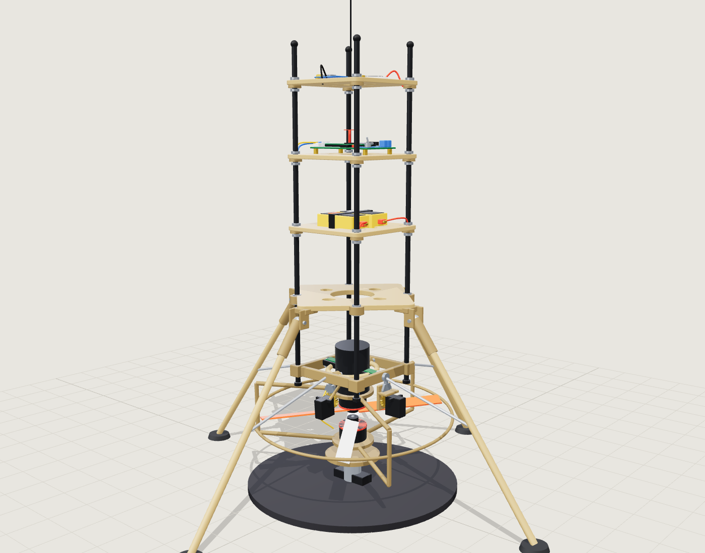

# Phase 2 design: RK-1 TVC rocket

Interactive: [web/rocket.html](../../web/rocket.html) · exploded: [rocket-exploded.png](../../assets/screenshots/rocket-exploded.png) · gimbal close-up: [rocket-gimbal.png](../../assets/screenshots/rocket-gimbal.png)

## 1. Concept

RK-1 is an **electric thrust-vector rocket**: a coaxial pair of brushless motors with contra-rotating propellers hangs in a **two-axis gimbal**, and two servos steer the whole motor assembly through reduction gears. Tilting the assembly tilts the thrust, which makes a torque about the centre of gravity (CG) and keeps the vehicle upright. Throttle sets the thrust; differential throttle between the two motors controls the spin about the vertical axis.

Three stack plates (battery, flight computer, telemetry) on four carbon rods sit above a diamond-shaped landing frame. Four splayed legs carry the landing loads. The CAD tree is `tvc`, `gear36t1/2`, `rods`, `landing-frame`, `battery-frame`, `pcb-frame`, `telemetry-frame`, `landing-gear`, `test-stand` (see [cad-mapping](../cad-mapping.md)).

The nozzle-equivalent (the prop disc) is **below** the CG. Without control the vehicle is like a broomstick balanced on a finger: any tilt grows. The controller feeds attitude and rate back to the gimbal so the thrust side force at the pivot always pushes the vehicle back upright.

## 2. Why a coaxial pair

A single propeller leaves a reaction torque that spins the vehicle. Two propellers turning in opposite directions on one axis cancel it, and the two motors give a free control channel about the vertical axis. A single motor would need straightening fins or vanes in the wash (as on the monocopter) or a separate roll actuator; a ducted fan would add noise and weight. See [design choices](../design-choices.md) D-01.

## 3. Geometry (from `src/data/spec.js`)

| Item | Value |
|---|---|
| Stack plates | 3 × 110 × 110 × 4 mm, 84 mm pitch; landing frame: 133 mm diamond |
| Rods | 4 × Ø6 mm carbon, 400 mm, on the diagonals at ±47 mm |
| Plate heights (to centre) | landing 238, battery 322, PCB 406, telemetry 490 mm |
| Gimbal pivot | 150 mm above the ground plane; range ±7° mechanical, ±6.5° software |
| Gears | 18T pinion, 36T sector, module 1, centre distance 27 mm, ratio 2:1 |
| Motor assembly | Ø42 mount tube; motor A at 112 mm, motor B at 68 mm; 9″ props at 98 and 84 mm; cage with Ø246 mm guard ring |
| Legs | 4 × Ø8, hinge radius 94 mm at 238 mm, foot radius 255 mm: 34° from vertical, Ø510 mm footprint |
| Overall height | ≈ 535 mm to the rod tops + ≈ 95 mm antenna |

## 4. Mass, CG and inertia (from the BOM)

Source: [`hardware/bom/rocket.json`](../../hardware/bom/rocket.json). On-board mass is **≈ 1.06 kg**.

| Group | Mass |
|---|---|
| Power (6S main pack, 2S avionics pack, BECs, wiring) | ≈ 305 g |
| Structure (rods, plates, landing frame, legs) | ≈ 296 g |
| Propulsion (2 motors, 2 props, 2 ESCs, cage, power board) | ≈ 278 g |
| Gimbal (frame, gears, 2 servos, pins) | ≈ 123 g |
| Hardware and avionics | ≈ 60 g |

| Quantity | Value | How |
|---|---|---|
| CG height | ≈ 243 mm above ground | Σ(m·y)/Σm using module heights |
| Lever arm pivot→CG `L` | ≈ 0.09 m | CG − 150 mm |
| Pitch/yaw inertia `I` | ≈ 0.019 kg·m² | Σ(m·d²) + own inertia of rods, plates, battery |
| Static restoring | none (CG above the thrust source) | needs the controller |

Weigh and balance the real vehicle (hang it on two cords), then put `L` and `I` in the [gimbal lab](../../web/gimbal.html) and the [PID lab](../../web/pid.html).

## 5. Thrust and endurance

Coaxial disc area (one 9″ prop): `A = π (0.114)² = 0.041 m²`.

| Quantity | Design value |
|---|---|
| Static thrust, two 3110-class motors on 6S, 9″ props | ≈ 2.6 kgf total (26 N) after the coaxial loss; recorded at Gate B |
| Thrust-to-weight (1.06 kg) | ≈ 2.5 |
| Hover thrust | 10.4 N, about 63 % throttle |
| Ideal hover power | `P = T^1.5 / √(2 ρ A) = 10.4^1.5 / 0.31 ≈ 108 W`; with a figure of merit ≈ 0.55 that is ≈ 200 W |
| Hover current (6S) | ≈ 9 A, so a 1500 mAh pack gives roughly 6 to 8 minutes of hover with 20 % reserve |

Plant gain `G = T·L/I` (rad/s² per rad of gimbal angle):

| Throttle | Thrust | G |
|---|---|---|
| Hover (≈ 63 %) | 10.4 N | ≈ 51 |
| 100 % | 26 N | ≈ 125 |

Gimbal authority is `M = T·L·sin δ`: at hover and δ = 6.5° it is 10.4 × 0.093 × 0.113 = 0.11 N·m, an angular acceleration of ≈ 6 rad/s². Authority grows with thrust, so gains are **scheduled** against throttle (the firmware multiplies them by `0.36 / thr²`). The [sizing page](../../web/sizing.html?model=rocket) shows the budget with your own numbers.

## 6. Structure

| Check | Result / method |
|---|---|
| Rod buckling | Four Ø6 mm carbon rods, 400 mm. Euler: `P = π² E I / (K L)²`, `I = π d⁴/64 = 63.6 mm⁴`, E ≈ 100 GPa (lower bound), K = 1 → ≈ 390 N per rod, ≈ 1570 N for four. Thrust is ≤ 30 N: a wide margin. Plates at every 84 mm shorten the free length |
| Leg tip-over | Foot radius 255 mm, CG 243 mm: tip-over angle ≈ atan(255/243) = 46° |
| Landing load | Drop-test from 0.3 m with a dummy mass before flying |
| Gimbal pins | M3 hardened pins in 683ZZ bearings: radial load ≈ thrust/2 per pin, far below rating |
| Prop clearance | Prop disc radius 114 mm, cage radius 123 mm; at 7° the cage moves ±15 mm, legs and braces are > 60 mm clear |

## 7. Design rules to keep

1. CG above the gimbal pivot, on the thrust axis, ±3 mm lateral.
2. Gimbal pivot on the thrust axis: the motor assembly rotates about it, so the thrust line always passes through the pivot.
3. Zero backlash in the gimbal (< 0.3°). Preload with washers.
4. The main pack (ESCs, servos) and the avionics pack are separate. Servo and ESC current spikes never reach the flight computer.
5. Every module is removable without disturbing the others.
6. Propellers are fitted last and removed for every bench test.
7. Antenna and GPS at the top, clear of the carbon rods.

## 8. Risks

| Risk | Mitigation |
|---|---|
| Control sign error flips the vehicle | Bench sign checks at Gate A, props off |
| Gimbal binds or has backlash | Calibration at Gate A with dial gauge or IMU |
| Not enough thrust or authority | Measure on the stand (Gate B/C); fall back to larger props or a higher-KV/6S combination |
| Spin (yaw) control saturates | Differential throttle is limited to keep both motors in range; check at the stand |
| Vibration on the IMU | Grommets, balanced props, check log noise |
| Brown-out or ESC noise | Separate avionics pack, capacitors at the ESCs, brown-out test at Gate A |
| Flyaway | Tether, tilt abort, link-loss cut, site and weather rules |
| Prop strike | Cage ring, shield on the stand, props off for bench work |
| Battery fire | LiPo rules in [safety](../safety.md) |
