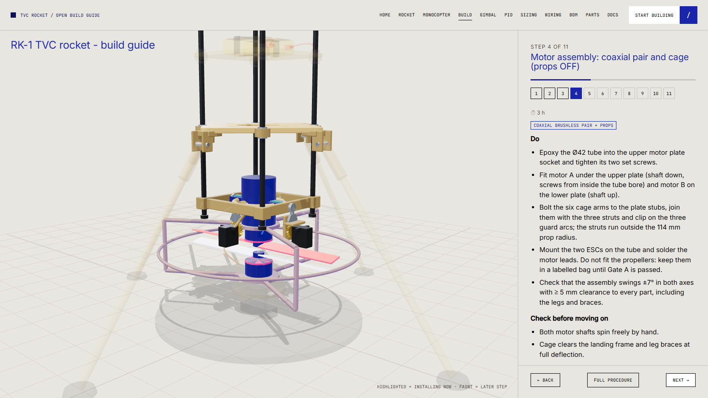

# Phase 2 build guide: RK-1 TVC rocket

Interactive version with each step highlighted on the model: **[web/assembly.html?model=rocket](../../web/assembly.html?model=rocket)**.

**Before you start:** read [safety](../safety.md). **Propellers stay off** for every step until the thrust stand: disconnect the motor leads from the ESCs whenever you work on software or wiring. Powered Phase 2 tests need Gate 3 (Phase 1 exit).

Tools: those of [Phase 1](../phase1-monocopter/03-build-guide.md) plus a dial indicator or phone angle app, M3 tap, 6 mm reamer, small files, thread-lock, CA glue, a scale, a prop balancer.

## Step 1: Print and prepare

All printable parts are in [`hardware/cad/stl/rocket/`](../../hardware/cad/stl/rocket/), already in print orientation; the list with quantities, sizes and materials is [cad-parts](../cad-parts.md). The smallest bed that fits everything is 220 × 220 mm.

| Do | Check |
|---|---|
| Print per [printing](../printing.md) and [cad-parts](../cad-parts.md): 3 stack plates (PETG), landing frame, gimbal mount / ring / collar, two servo brackets, two motor plates, six cage arms, three struts, three guard arcs, four leg hinges, four brace clips (PA-CF or PETG), two pinions (PA12 or metal) | Weights vs BOM ±10 % |
| Cut four Ø6 mm carbon rods to 400 mm; deburr; seal ends with thin CA (gloves and a mask when cutting carbon) | Rods straight, equal length ±0.5 mm |
| Press M3 heat-set inserts: 3 in the telemetry plate, 4 in the PCB plate, 2 under the gimbal mount, 2 on top of the outer ring, 4 in each cage strut | Flush, square |
| Ream the rod holes to Ø6.2 mm and the two bearing bores in each of the outer ring and collar to Ø7.0 mm if tight; clear the Ø8.2 leg sockets with an 8 mm drill | Rod slides through every boss by hand; 683ZZ presses in by hand pressure |

## Step 2: Gimbal mechanics (`tvc`)

Pivot hardware per pivot: one 683ZZ bearing, one M3 bolt, one M3 nylock nut. The two X pivots use M3 × 20, the two Y pivots use M3 × 16.

1. **Outer ring on the mount (X axis).** Press a 683ZZ into each X boss of the outer ring from the cavity side (the bore opens into the ring). Place the ring in the mount cavity. Drop an M3 × 20 into each bore from the cavity side, so the head sits on the bearing's inner race; the shank runs through the bearing, the small pip on the mount, the mount member, and into the nylock nut pocket on the **outer** face of the member.
2. Tighten each nut until the bearing **just starts to drag**, then back off about 1/8 turn. The ring must swing freely and without end play.
3. **Collar in the ring (Y axis).** Press a 683ZZ into each Y boss of the collar from the bore side. Lower the collar into the ring from above. Drop an M3 × 16 into each boss from inside the collar bore; the shank passes through the bearing and the pip on the ring into the nylock nut pocket on the ring's outside. Adjust the same way.
4. Slide the Ø42 tube through the collar and clamp it with the four M3 set screws (two above and two below the ring plane). Do not glue it.
5. Slide the mount onto the four rods so the **pivot centre is 150 mm above the ground datum** (rods stand on a flat table; the rod ends are 8 mm below the underside of the mount). Lock each corner with its M3 clamp screw (M3 × 8 into the nut slot).

**Check:** each axis swings through ±7° freely; axial and radial play < 0.3° (dial indicator at the collar, 100 mm from the pivot: < 0.5 mm).

## Step 3: Gear stages (`gear36t1`, `gear36t2`)

The 36-tooth sectors are part of the outer ring (axis 1) and the collar (axis 2). You only fit the pinions and servos.

1. Axis 1: screw servo bracket 1 under the +X member of the mount (2 × M3 × 10 into the inserts). Axis 2: screw servo bracket 2 on top of the outer ring on the +Y side (2 × M3 × 10 into the inserts).
2. Fit each servo in its bracket window with four M2 self-tapping screws; the shaft must point at the sector. The brackets set the **27.0 mm centre distance** (module 1: pitch radii 18 and 9 mm).
3. Centre each servo at 1500 µs **before** meshing, with the tube exactly vertical (square on two sides).
4. Press a pinion on each servo spline (retain it with the horn screw). Rotate it on the spline until its tooth **gap** is centred on the sector tooth that faces it.
5. Backlash: a sheet of 80 g paper between teeth is about right.
6. Axis 2 servo rides on the outer ring: leave a strain-relieved service loop in its cable (it moves ±7° with axis 1).

**Check:** servo ±14° ↔ gimbal ±7°; gears do not skip at full deflection by hand; no rubbing against the legs or braces.

## Step 4: Motor assembly (`motor`), props OFF

1. Epoxy the Ø42 tube into the socket of the upper motor plate and tighten its two M3 set screws. The tube bottom rests on the plate.
2. Fit motor A under the upper plate (shaft down): four M3 from inside the tube bore (the Ø19 pattern is reached through the bore). Fit motor B on top of the lower plate (shaft up): four M3 from below.
3. Fit the six cage arms: each arm laps under a stub of its plate and is held by two M3 × 12 screws and nuts. Join the arms with the three struts (M3 × 10 through each arm tip into the strut inserts), then clip the three guard arcs onto the struts with M3 × 10.
4. Mount the two ESCs on the tube above the collar and solder motor leads (short, twisted). Fit 1000 µF capacitors at the power board.
5. **Do not fit the propellers.** Balance them on a prop balancer now (sand the heavy blade or tape the light one) and put them in a labelled bag. Both props must blow air **downward**: the upper prop sits below its motor, so it is a **pusher** type; the lower prop sits above its motor, so it is a **standard** type. Order them with the rotation directions of step 6.
6. Set motor directions in the ESC configurator with the props off: motor A turns the prop clockwise seen from above, motor B counter-clockwise.

**Check:** the assembly swings ±7° in both axes with ≥ 5 mm clearance to every part (landing frame, braces, legs); both shafts spin freely by hand.

## Step 5: Landing frame and legs (`landing-frame`, `landing-gear`)

1. Slide the diamond landing frame onto the rods at 238 mm and lock it with the M3 clamp screw at each rod. Its four corners point along the leg axes.
2. Epoxy a leg hinge fitting onto each Ø8 × 260 mm carbon leg (22 mm deep, rod end 12 mm from the pin). Hinge the legs between the lug ears with an M3 bolt and nylock nut (hinge radius 94 mm). Fit rubber feet.
3. Slide a brace clip onto each leg at its midpoint (M3 grub screw). Form the 1.6 mm brace wire so one end hooks into the clip eyelet and the other into the Ø2.2 anchor hole in the underside of the gimbal mount.

**Check:** the footprint is level within 2 mm; the vehicle stands upright; push test: no tipping up to ≈ 30° of lean.

## Step 6: Stack plates (`battery-frame`, `pcb-frame`, `telemetry-frame`)

Install bottom-up and lock each plate with the M3 clamp screw at each rod boss:

| Plate | Centre height | Contents |
|---|---|---|
| battery-frame | 322 mm | 6S 1500 mAh main pack and 2S 450 mAh avionics pack side by side under a Velcro strap |
| pcb-frame | 406 mm | Flight computer: Teensy 4.1, IMU, baro, servo BEC, 5 V regulator, fuse, RBF pin, arm switch |
| telemetry-frame | 490 mm | ELRS receiver, GPS puck, whip antenna, buzzer / LEDs |

1. Build the flight-computer board per [04-wiring](04-wiring.md). Mount on brass standoffs with silicone grommets, IMU near the stack axis.
2. Wire the main pack → RBF pin / arm → power board → ESCs and servo BEC; the avionics pack → 5 V regulator → logic. **One ground star point.**
3. Route servo and ESC cables along a rod with zip ties; leave the axis 2 service loop.
4. Antenna vertical, ≥ 20 mm from carbon rods; GPS puck on top.

**Check:** with the RBF pin inserted nothing powers up; with the pin out and the arm switch off, only logic is alive: ESC outputs idle, servos centred (SAFE state).

## Step 7: Mass and balance

1. Weigh the vehicle without props: compare with the BOM (≈ 1.06 kg).
2. Find the CG (hang on two cords): expect ≈ 243 mm above the ground. Lateral CG offset ≤ 3 mm (move the packs).
3. Update `L` (CG − 150 mm) and estimate `I` (bifilar pendulum or the CAD): put both in the PID lab and the gimbal lab.

## Step 8: Firmware and Gate A

Flash [`firmware/rocket`](../../firmware/rocket/) and run the **sign checks and gimbal calibration** in [06-firmware-and-gnc](06-firmware-and-gnc.md) and [05-gimbal-design](05-gimbal-design.md) (Gate A), props off. Then the stand procedures in [07-test-stand-procedure](07-test-stand-procedure.md).

## Troubleshooting

| Symptom | Likely cause |
|---|---|
| Gimbal sticks mid-travel | Pin pre-load too high; printed bosses out of round |
| Gears clatter | Centre distance too large; add preload or reduce to 27.0 mm |
| One axis moves the wrong way | Servo mirrored: set `GimbalMap.sign = -1` for that axis, then repeat the sign check |
| IMU shows tilt on a level vehicle | Board not square to the stack axis or bad gyro bias: recalibrate at rest |
| Servos reset the flight computer | Servo BEC on the avionics pack, weak ground, no fuse or capacitor |
| One motor spins the wrong way | Swap two motor leads or reverse it in the ESC configurator, then repeat the direction check |
| Vehicle spins on the stand | Spin gain sign wrong, or thrust of the two motors unequal: check the sign in the log and trim the lower motor |
| Cage hits the landing frame | Mount tube not centred in the collar |
