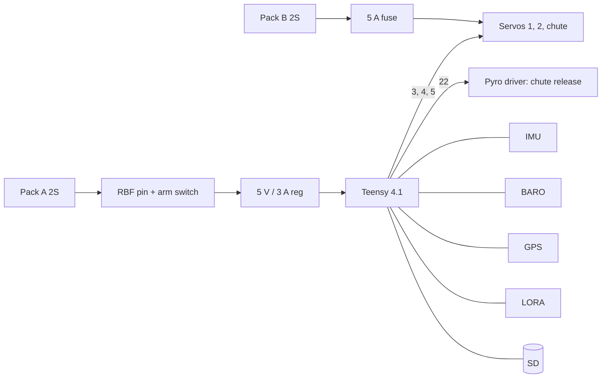

# Phase 2 wiring: RK-1 TVC rocket

Interactive diagram: [web/wiring.html?model=rocket](../../web/wiring.html?model=rocket). Pin map source of truth: [`firmware/rocket/include/pins.h`](../../firmware/rocket/include/pins.h).

## Pin map (Teensy 4.1)

| Pin | Function | Connected to |
|---|---|---|
| 10 / 11 / 12 / 13 | SPI0 CS / MOSI / MISO / SCK | ICM-42688-P |
| 9 | IMU INT | ICM-42688-P INT1 |
| 18 / 19 | I²C SDA / SCL | BMP390 (0x76), ADXL375 (0x53, optional) |
| 7 / 8 | Serial2 RX / TX | GPS u-blox M10 |
| 16 / 17 | Serial4 RX / TX | LoRa module (UART mode) |
| 3 | Servo axis 1 | Gimbal servo 1 |
| 4 | Servo axis 2 | Gimbal servo 2 |
| 5 | Servo chute | Release servo (optional) |
| 22 | Pyro gate 1: chute release | MOSFET gate, 10 kΩ pull-down |
| 23 | Pyro gate 2: spare | MOSFET gate, 10 kΩ pull-down |
| 40 / 41 | Continuity sense | Pyro channels 1 / 2 (ADC) |
| 24 | RBF sense | Pull-up; pin inserted = grounds the input |
| 25 | Arm switch | Pull-up; switch on = grounds the input |
| 38 / 39 | Pack A / B voltage | 1:3 dividers (ADC) |
| 6 / 28 | Buzzer / status LED | |

## Power

| Rail | Source | Loads |
|---|---|---|
| 7.4 V (A) | 2S 850 mAh | via RBF + arm → 5 V regulator → Teensy, sensors, GPS, LoRa, buzzer |
| 7.4 V (B) | 2S 850 mAh | via 5 A fuse → servos (HV-rated), chute servo |
| 5 V logic | regulator 3 A | Teensy VIN |

Why two packs: gimbal servos stall-peak at 1 to 2 A each when the gimbal fights a load; on a shared supply that dips the logic rail. Separate packs remove the problem and give a hardware kill for the servos.

## Pyro and ignition rules

- **The flight computer never ignites the motor.** The ground ignition controller does.
- Pyro channel 1 only releases the parachute (e-match or servo). Outputs are LOW at boot, held low by 10 kΩ pull-downs, and wired through the RBF pin, so the channel is physically dead with the pin inserted.
- Continuity sense lines let you verify the e-match on the pad (small sense current, below e-match no-fire).
- Test with **LED dummy loads only**; connect an e-match only at the range after the vehicle is on the stand/pad.

## Harness rules

1. One ground star point on the flight-computer board.
2. Locking connectors (JST-GH / Molex) everywhere; no bare Dupont leads.
3. Servo cables tie-wrapped along the rods; service loop at the axis 2 servo.
4. Keep power leads and servo leads ≥ 20 mm from the IMU and antenna.
5. Label every connector and photograph the harness before and after changes.

## Verification checklist

- [ ] RBF inserted: nothing powers (measure with a meter).
- [ ] RBF out, arm off: logic powered, servo outputs idle (no pulses), pyro outputs LOW.
- [ ] Pack voltage readings on the console match a meter within 0.1 V.
- [ ] All servo signs verified (see [06](06-firmware-and-gnc.md)).
- [ ] Continuity sense shows open with no e-match, closed with a 1 Ω dummy.
- [ ] LoRa packets received at the ground station; GPS fix outdoors.
