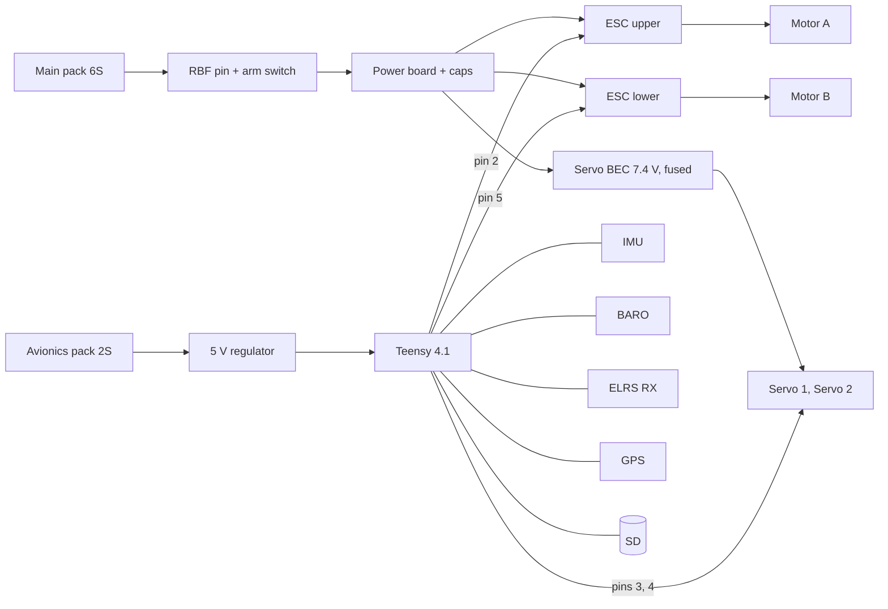

# Phase 2 wiring: RK-1 TVC rocket

Interactive diagram: [web/wiring.html?model=rocket](../../web/wiring.html?model=rocket). Pin map source of truth: [`firmware/rocket/include/pins.h`](../../firmware/rocket/include/pins.h).

## Pin map (Teensy 4.1)

| Pin | Function | Connected to |
|---|---|---|
| 10 / 11 / 12 / 13 | SPI0 CS / MOSI / MISO / SCK | ICM-42688-P |
| 9 | IMU INT | ICM-42688-P INT1 |
| 18 / 19 | I²C SDA / SCL | BMP390 (0x76) |
| 0 / 1 | Serial1 RX / TX, 420 000 baud | ELRS receiver (CRSF) |
| 7 / 8 | Serial2 RX / TX | GPS u-blox M10 |
| 2 | ESC upper, 400 Hz PWM | ESC A (clockwise prop) |
| 5 | ESC lower, 400 Hz PWM | ESC B (counter-clockwise prop) |
| 3 | Servo axis 1 | Gimbal servo 1 |
| 4 | Servo axis 2 | Gimbal servo 2 |
| 24 | RBF sense | Pull-up; pin inserted = grounds the input |
| 25 | Arm switch | Pull-up; switch on = grounds the input |
| 38 / 39 | Main / avionics pack voltage | 1:10 and 1:3 dividers (ADC) |
| 6 / 28 | Buzzer / status LED | |

The flight computer arms only when **both** the on-board arm switch and the radio arm channel (AUX1 > 1700 µs) are on: the radio switch doubles as the kill switch.

## Power

| Rail | Source | Loads |
|---|---|---|
| 22.2 V main | 6S 1500 mAh via RBF + arm → power board | two ESCs, servo BEC |
| 7.4 V servo | BEC 5 A from the main pack, 5 A fuse | two HV servos |
| 7.4 V avionics | 2S 450 mAh | 5 V regulator → Teensy, IMU, baro, GPS, ELRS receiver, buzzer |

Why two packs: the ESCs and servos make large current spikes and electrical noise. A separate small avionics pack keeps the flight computer, the log and the receiver alive and clean even if the main pack sags or the RBF pin is pulled.

Motor leads: 14 AWG silicone, short, twisted in pairs. A 1000 µF 35 V low-ESR capacitor sits across each ESC's power pads. Keep them ≥ 20 mm from the IMU and the receiver antenna.

## Rules

- The **RBF pin or loop breaks the main-pack supply**: with it inserted the motors and the servos cannot move.
- ESC signal lines have 10 kΩ pull-downs so a floating pin never commands thrust; the firmware sets both outputs to zero before anything else.
- Props off for every wiring test; disconnect the motor leads from the ESCs when testing software.
- One ground star point on the flight-computer board.
- Locking connectors everywhere; no bare Dupont leads.
- Photograph the harness before and after every change.

## Verification checklist

- [ ] RBF inserted: nothing powers (measure with a meter).
- [ ] RBF out, arm off: logic powered, ESC outputs at 1000 µs, servos centred.
- [ ] Both ESCs play their start-up tones on power-up; each motor spins the right way (props off, a brief blip from the ESC configurator motor test).
- [ ] Pack voltage readings on the console match a meter within 0.1 V.
- [ ] All servo signs verified (see [06](06-firmware-and-gnc.md)).
- [ ] Radio channels move as expected on the console; failsafe tested (switch the radio off: ESC to 1000 µs within 0.3 s).
- [ ] GPS fix outdoors.
