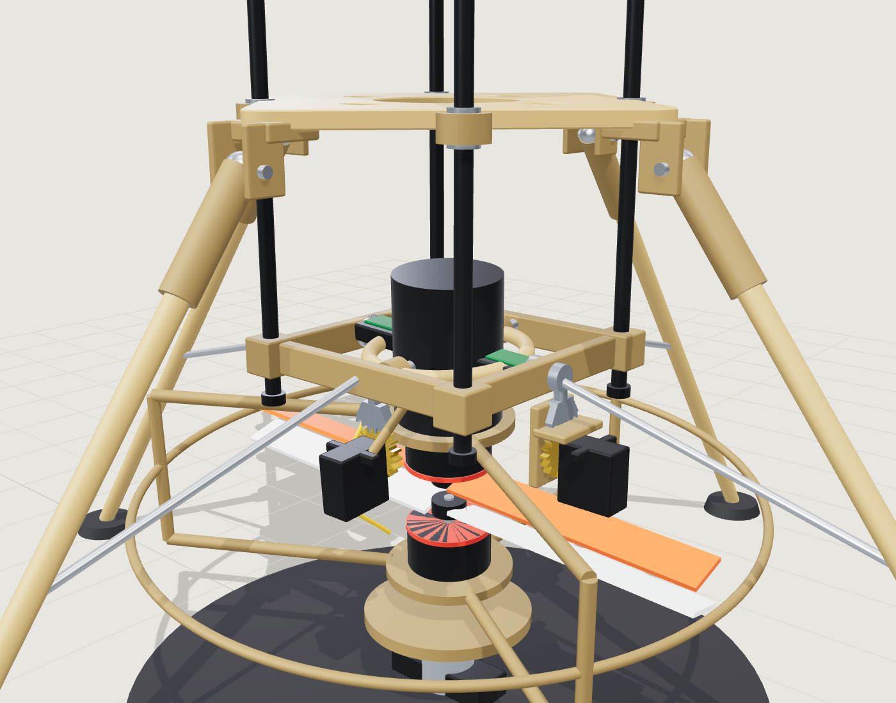

# Gimbal design, calibration and Gate A

Interactive: [Gimbal lab](../../web/gimbal.html) and the live gimbal in [rocket.html](../../web/rocket.html).



## 1. Kinematics

Two nested axes. The outer ring pivots about X on 683ZZ bearings in its two bosses, on M3 bolts fixed to the mount (rod-mounted). The inner collar pivots about the second horizontal axis (Y in the CAD frame) on 683ZZ bearings in its bosses, on M3 bolts fixed to the ring, and clamps the motor mount tube with four set screws. Both axes pass through the **pivot point** at 150 mm height, and the motor assembly (two motors, two props, cage) rotates as one body about it.

For small angles the thrust tilts by the two angles independently. At the largest angles (±7°) the coupling error is `≈ θx θz / 2 ≈ 0.003 rad (0.17°)`: negligible.

Thrust `T` tilted by `δ` gives a side force `T sin δ` through the pivot. Restoring torque about the CG: `M = T sin δ · L`, `L ≈ 0.093 m`. Angular acceleration `α = M / I`, `I ≈ 0.019 kg·m²`.

## 2. Gear stage

| Item | Value |
|---|---|
| Sector | 36 teeth, module 1 (pitch Ø36 mm), 4 mm face width, arc ±26°; printed into the outer ring (axis 1) and the collar (axis 2) |
| Pinion | 18 teeth, module 1 (pitch Ø18 mm), 4 mm face, Ø4.7 bore for a 25T servo spline |
| Centre distance | (36 + 18)/2 = 27.0 mm, fixed by the servo brackets |
| Ratio | 2:1: servo angle = 2 × gimbal angle |
| Travel | gimbal ±7° → servo ±14° |
| Resolution | servo ≈ 10 µs/° → 1 µs = 0.1° servo = **0.05° gimbal** |
| Speed | servo 0.08 s/60° ≈ 750°/s → gimbal 375°/s (6.5 rad/s) |

Why a reduction? It halves servo quantisation and slop at the thrust vector, doubles torque at the gimbal, and keeps the servo in the middle of its travel. Cost: half the angular speed, still ≈ 10× faster than the loop needs ([PID lab](../../web/pid.html): 6 rad/s rate limit, peak demand 2 to 3 rad/s).

**Servo torque check.** The thrust line passes through the pivot, so the holding torque is small: `M = T · d · sin δ + friction + inertia`, where `d` is the offset between the assembly's own CG and the pivot. For the motor assembly (≈ 280 g) with its CG 30 mm below the pivot, the gravity torque at 7° is `0.28 × 9.81 × 0.03 × sin 7° = 0.01 N·m`. With friction (≈ 0.02 N·m) and the acceleration of the assembly's inertia (≈ 0.002 kg·m² at 50 rad/s² = 0.1 N·m peak) the servo needs about 0.06 N·m (0.6 kg·cm) after the 2:1 gear, well inside a 4.5 kg·cm servo. **Balance the assembly so its CG sits on the pivot** (move the ESCs up or down the tube): that removes most of the load.

### Pivot detail (design values)

| Item | Value |
|---|---|
| Pivot hardware | 683ZZ bearing (3 × 7 × 3), M3 bolt, M3 nylock nut, per pivot |
| Pivot axis height | 150 mm above the ground datum; the mount is 14 mm tall, centred on it |
| Mount cavity | 82.8 mm square; ring OD 72 mm, ID 60 mm, 12 mm tall; collar OD 50 mm, 26 mm tall, tube bore Ø42.3 mm |
| Bearing seat | Ø7.0 mm bore, 3 mm deep, 1 mm lip with a Ø5 mm hole; the bolt head clamps the inner race against a 1.4 mm pip on the fixed part |
| Clearance at ±7° | ring to mount 5.4 mm; collar to ring 5 mm; checked for interference at nine gimbal poses by `npm run cad:assembly` |

## 3. Mechanical requirements

| ID | Requirement | Check |
|---|---|---|
| RK-03 | ±7° mechanical, ±6.5° software, both axes | Sweep by hand to the stops |
| RK-04 | Backlash < 0.3° at the mount tube | Dial indicator 100 mm from the pivot: < 0.5 mm |
| RK-05 | 3° step ≤ 60 ms to 90 %, unloaded | IMU/phone slow-motion video |
| – | Friction: assembly swings under its own imbalance | No stick-slip |
| – | Clearance ≥ 5 mm at full deflection in both axes (and combined) | Props off |

## 4. Calibration procedure (Gate A)

Do this with the **propellers removed and the motor leads disconnected from the ESCs**, vehicle on the bench, servo BEC powered through its fuse, RBF out.

1. **Centre.** Command the gimbal to 0° and use a square (or phone angle app on the tube) to set the tube vertical. Adjust `ServoMap.centerUs` / `trimDeg` per axis until it is. Note the values.
2. **Direction.** Command +3° on axis 1. Record which way the nozzle end of the assembly moves (and the same for axis 2). Compare with the torque convention in [06](06-firmware-and-gnc.md); set `GimbalMap.sign` accordingly.
3. **Gain.** Command −6, −3, 0, +3, +6° and measure with the angle app. Fit `measured = a · commanded + b`. Expect `a ≈ 1.0 ± 0.05`. If not, adjust `usPerDeg` for that servo.
4. **Backlash.** Command 0°, then +1°, 0°, −1°, 0°, … and measure the dead-band at the tube. Must be < 0.3°.
5. **Step response.** 3° step, 10 repeats, slow-motion video or IMU log. 90 % time ≤ 60 ms (RK-05). The number goes into `act.tau` of the PID lab.
6. **Sweep.** Circle sweep at ±5° for 60 s. Servo temperatures < 50 °C, no skipped gear teeth.
7. **Brown-out.** Hold one axis by hand at a stall for 2 s; the Teensy must not reset.
8. **Failsafes.** Arm switch off: gimbal centres and the ESC outputs are at 1000 µs. Radio off: the same within 0.3 s.
9. **Interlocks.** With the RBF pin inserted nothing moves; arming is refused when the throttle stick is up or the tilt is > 10°.
10. **Mass and balance** (see [03-build-guide](03-build-guide.md) step 7), and balance the motor assembly on the pivot.

## 5. Gate A pass criteria

All of the following, recorded in a test log:

- ☐ Centre within 0.3°; gain 1.0 ± 0.05 on both axes
- ☐ Signs verified and `GimbalMap.sign` committed
- ☐ Backlash < 0.3°; step 90 % time ≤ 60 ms
- ☐ 60 s sweep without skipping or overheating
- ☐ No brown-out at stall
- ☐ RBF / arm / link-loss interlocks verified (SYS-01, RK-06, RK-07)
- ☐ CG within ±10 mm of 243 mm (±3 mm laterally)
- ☐ Measured actuator lag and rate entered in the PID lab and gains re-tuned in simulation

## 6. Tuning gains

`G = T L / I` depends on thrust, so it changes with throttle. Pick a natural frequency `ωn` (6 to 8 rad/s at hover is a good start) and damping ratio 0.7:

```
Kp = ωn² / G        Kd = 2 ζ ωn / G        Ki ≈ 0.15 · Kp
```

| Thrust | G | Kp (ωn = 8) | Kd |
|---|---|---|---|
| Hover, 10.4 N | 51 | 1.25 | 0.22 |
| 15 N | 74 | 0.86 | 0.15 |
| Full, 26 N | 127 | 0.50 | 0.09 |

The firmware tunes at hover and scales the output by `0.36 / throttle²`, because thrust (and so `G`) grows roughly with the square of the throttle. Check the scheduling on the stand: log the commanded gimbal angle against throttle during a step and look for oscillation at either end.
