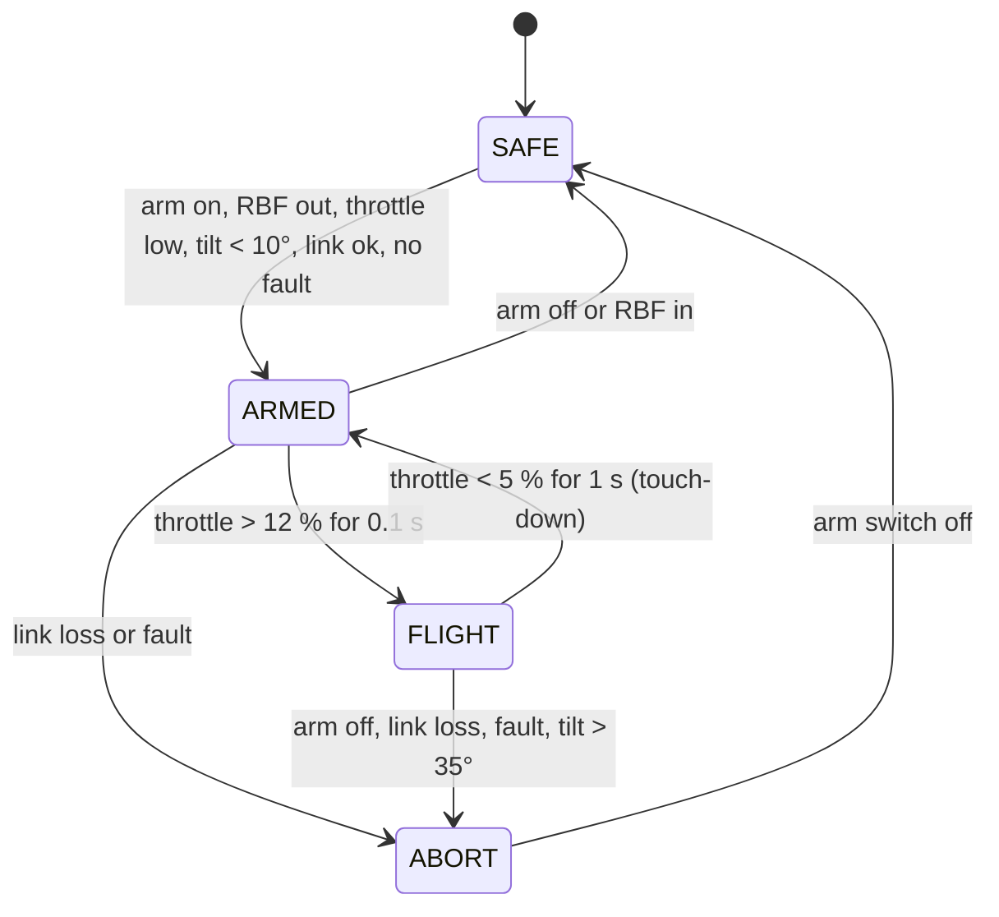

# Phase 2 firmware and GNC

Code: [`firmware/rocket/src/main.cpp`](../../firmware/rocket/src/main.cpp), core in [`firmware/lib/tvc_core/`](../../firmware/lib/tvc_core/). Simulation twin: [PID lab](../../web/pid.html).

## 1. Flight states



| State | Motors | Gimbal | Logging |
|---|---|---|---|
| SAFE | off (1000 µs) | centred, controller off | off |
| ARMED | off | centred | on |
| FLIGHT | throttle + spin mix | **closed loop** | on (250 Hz) |
| ABORT | **off** | centred | on |

All transitions are covered by [`host_tests.cpp`](../../firmware/test/host_tests.cpp). The arm switch on the radio is also the **kill switch**: switching it off in FLIGHT enters ABORT (motors cut). Both the on-board switch and the radio switch must be on to arm.

## 2. Estimator and attitude error

Mahony filter on IMU data, 500 Hz. The accelerometer is ignored outside 0.5 to 1.5 g, so a vibration burst or an aggressive manoeuvre does not corrupt the attitude. Gyro bias is measured at boot (2 s, vehicle still).

The rocket's body X axis is the **nose axis**, pointing up. The attitude error of the nose relative to vertical is the rotation vector that takes the nose to world-up, in the body frame:

```
e_body = n_body × up_body   with  n_body = (1,0,0)
up_body = -(third row of R) = -[2(xz − wy), 2(yz + wx), w² − x² − y² + z²]
=> e_y (pitch error) =  w² − x² − y² + z²
   e_z (yaw error)   = -2 (yz + wx)
```

Both are small-angle errors in radians, zero when the nose points straight up. Tilt for the abort check: `acos(−R31)`. Pilot pitch/roll sticks add up to ±5° to the set-point.

## 3. Control law

**Gimbal (two axes):** `δ = (Kp·e + ∫Ki·e − Kd·ω) · gs`, saturated at ±6.5°, derivative on the gyro rate. Gains at hover (from the PID lab preset): `Kp 1.2, Ki 0.2, Kd 0.21`. `gs = 0.36 / throttle²` (clamped to 0.5 to 2.5) because the gimbal authority grows with thrust. The controller runs only in FLIGHT; integrators reset otherwise.

**Spin about the vertical axis:** `spin = Kspin · (rate_sp − gyro_x)` (X is the nose axis, so positive spin is counter-clockwise seen from above; yaw stick right commands clockwise), then `mixCoax(throttle, spin)`: upper motor = throttle + spin, lower motor = throttle − spin, with the spin limited so neither motor clips. The yaw stick sets `rate_sp` (±90°/s).

**Throttle:** the pilot's throttle, limited to 90 % so the differential has headroom. There is no altitude hold in the baseline: the pilot flies the throttle.

## 4. Sign convention (verify at Gate A)

Aerospace FRD, X along the nose. A positive controller output on an axis must produce a positive torque about the matching body axis.

For a prop disc below the CG, a restoring torque needs the **side force on the vehicle at the thrust source to point toward the side the nose is leaning to**. Because the thrust is along the motor axis, that means the **lower end of the motor assembly swings away from the lean side**. How that maps to "positive servo microseconds" depends on how each servo and gear are mounted, so the sign is a **configuration value** (`GimbalMap.sign`) set by a physical test:

1. Propellers removed, motor leads disconnected, vehicle on the bench, logic and the servo BEC powered.
2. Tilt the vehicle about one horizontal axis by ~10° by hand and hold it. With the controller enabled (bench mode below) the lower end of the motor assembly must move **away from the lean side** (nose leans right: lower end swings left).
3. Repeat for the other axis.
4. If wrong, flip that axis' `sign`, repeat 2 and 3, **write the result in the test log**.
5. **Spin sign:** the upper prop turns clockwise seen from above, so speeding the upper motor up pushes the body counter-clockwise (reaction torque). On the stand at low throttle a yaw-stick-right input must turn the vehicle **clockwise** seen from above (lower motor faster). If it turns the other way, either the props are swapped or the sign of `SPIN_KP` is wrong: fix it and log the result.

*Bench mode:* force `fsm.gimbalEnabled()` to true under a compile flag in a private branch. **Never** with propellers fitted. Remove it before any powered test; the unit tests assert that the gimbal and the motors are enabled only in FLIGHT.

The monocopter obeys the same rule in another form: vane forces push the bottom of the vehicle toward the lean side ([phase 1 firmware doc](../phase1-monocopter/05-firmware-and-control.md) §3).

## 5. Parameters to set

| Parameter | File | Meaning |
|---|---|---|
| `GAINS_TILT` | `main.cpp` | PID gains at hover, output in rad |
| `HOVER_THROTTLE` | `main.cpp` | Throttle at which the gains were tuned (0.60) |
| `SPIN_KP`, `MAX_SPIN_RATE` | `main.cpp` | Differential-throttle spin loop |
| `MAX_THROTTLE` | `main.cpp` | 0.90 |
| `map1`, `map2` | `main.cpp` | Gear ratio, limit, sign, servo centre / µs per degree |
| `FlightConfig` | `flight_state.h` | Arm limits (throttle < 5 %, tilt < 10°), spool 12 %, idle 5 %, abort tilt 35° |
| `PIN_*` | `include/pins.h` | Pin map |

## 6. Logging

`flight.csv` on SD: `ms,state,tilt_deg,thr,err_pitch,err_yaw,gimbal1_deg,gimbal2_deg,spin_cmd,alt_m`. Logging runs while ARMED or in FLIGHT and is flushed every 2 s. Link statistics and battery voltage are shown on the radio through the ELRS telemetry.

## 7. Health monitoring

`FlightInputs.fault` is the single hook for health checks: set it from an IMU timeout, a main-pack voltage below 3.4 V per cell under load, or an SD failure. A fault in FLIGHT enters ABORT (motors cut); in SAFE or ARMED it blocks arming. Add the checks that suit your hardware and give each a bench test.

## 8. Host tests

```bash
npm run test:firmware   # 61 checks: PID, AHRS, nose tilt, mixers, CRSF, state machine
npm test                # JS simulation
```
