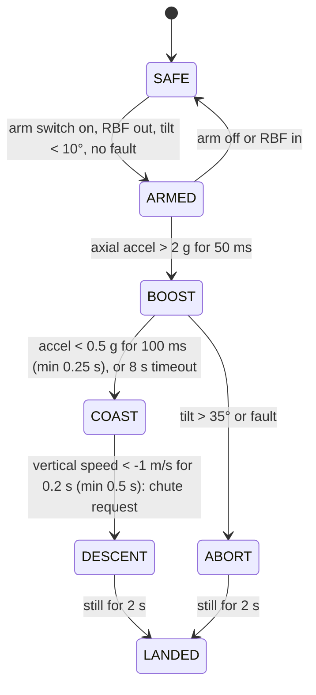

# Phase 2 firmware and GNC

Code: [`firmware/rocket/src/main.cpp`](../../firmware/rocket/src/main.cpp), core in [`firmware/lib/tvc_core/`](../../firmware/lib/tvc_core/). Simulation twin: [PID lab](../../web/pid.html).

> **Status:** the portable core is host-tested (PID, AHRS, mixers, CRSF, flight-state machine). The Teensy project has **never been compiled for the target nor run on hardware.** Treat it as a skeleton for bring-up and review every line before a powered test.

## 1. Flight states



| State | Gimbal | Servos | Logging | Chute |
|---|---|---|---|---|
| SAFE | centred, controller off | **not driven** | off | no |
| ARMED | centred | holding centre | off (pad idle) | no |
| BOOST | **closed loop** | active | 250 Hz | no |
| COAST | centred | active | on | no |
| DESCENT | centred | active | on | **requested once** |
| ABORT | centred | active | on | **requested** |
| LANDED | centred | not driven | off | – |

All transitions are covered by [`host_tests.cpp`](../../firmware/test/host_tests.cpp). Ignition is **not** a state: the ground controller lights the motor.

## 2. Estimator and attitude error

Mahony filter on IMU data, 500 Hz (accelerometer ignored outside 0.5 to 1.5 g, e.g. during the burn: the attitude then comes from gyro integration, so keep the gyro bias calibrated and expect drift of a few degrees per minute: fine for a 2 s burn).

The rocket's body X axis is the **nose axis**, pointing up on the pad. The attitude error of the nose relative to vertical is the rotation vector that takes the nose to world-up, expressed in the body frame:

```
e_body = n_body × up_body   with  n_body = (1,0,0)
up_body = -(third row of R) = -[2(xz − wy), 2(yz + wx), w² − x² − y² + z²]
=> e_y (pitch error) =  w² − x² − y² + z²
   e_z (yaw error)   = -2 (yz + wx)
```

Both are small-angle error angles in radians, zero when the nose points straight up. Tilt for the abort check: `acos(−R31)`.

## 3. Control law

Per axis: `δ = Kp·e + ∫Ki·e − Kd·ω`, saturated at ±6.5°, derivative on the gyro rate. Gains for F-class (T ≈ 30 N, `G` ≈ 168): `Kp 0.8, Ki 0.1, Kd 0.1` (matches the PID lab preset and the host test). The controller runs **only in BOOST**; its integrators are reset in every other state.

Output is a gimbal angle in degrees → `GimbalMap` → servo microseconds (ratio 2:1, software limit 6.5°).

## 4. Sign convention (must be verified, Gate A)

Aerospace FRD, X along the nose. Convention used by the code:

> **A positive controller output on an axis must produce a positive torque about the matching body axis** (pitch: about +Y; yaw: about +Z).

For a nozzle below the CG, a restoring torque needs the **side force on the vehicle at the tail to point toward the side the nose is leaning to**. Because thrust on the vehicle is opposite to the exhaust direction, that means the **nozzle end of the motor tube swings away from the lean side**. How that maps to "positive servo microseconds" depends on how each servo and gear are mounted, which is why the sign is a **configuration value** (`GimbalMap.sign`) set by a physical test:

1. Dummy motor installed, vehicle on the bench, nothing powered except logic + pack B.
2. Tilt the vehicle by ~10° about one horizontal axis by hand and hold it. With the controller enabled (bench mode below) the nozzle end must move **away from the lean side** (nose leans right: nozzle swings left).
3. Repeat for the other axis.
4. If wrong, flip that axis' `sign`, repeat 2 and 3, **write the result in the test log**.

The monocopter obeys the same rule in a different form: vane forces push the bottom of the vehicle toward the lean side ([phase 1 firmware doc](../phase1-monocopter/05-firmware-and-control.md) §3).

*Bench mode:* temporarily force `fsm.gimbalEnabled()` to true under a compile flag in a private branch. **Never** with a motor installed. Remove before any powered test; the unit tests assert gimbal enable only in BOOST.

## 5. Parameters to set

| Parameter | File | Meaning |
|---|---|---|
| `GAINS_PITCH`, `GAINS_YAW` | `main.cpp` | PID gains, output in rad |
| `map1`, `map2` | `main.cpp` | Gear ratio, limit, sign, servo centre/µs per degree |
| `FlightConfig` defaults | `flight_state.h` | Launch 2 g/50 ms, burnout 0.5 g/100 ms, apogee −1 m/s, landed 2 s, tilt abort 35° |
| `PIN_*` | `include/pins.h` | Pin map |

## 6. Telemetry and logging

- `$TVC,<ms>,<state>,<tilt_deg>,<alt_m>,<vz_mps>` on the LoRa UART at 5 Hz (add GPS fix and battery voltage next).
- `flight.csv` on SD: `ms,state,tilt_deg,axialG,err_pitch,err_yaw,gimbal1_deg,gimbal2_deg,alt_m,vz_mps`. Logging runs only between ARMED and LANDED to keep the file small; the logger writes at 250 Hz in BOOST.

## 7. TODOs before any flight

- [ ] Battery low and IMU timeout faults (`FlightInputs.fault`) with real conditions, each with a bench test.
- [ ] High-g accelerometer integration for launch/burnout detection (IMU saturates at ±16 g).
- [ ] False-launch rejection test on a vibration table or by driving over bumps with the board in the car (not armed in a vehicle with a motor!).
- [ ] Servo power switching and a brown-out detector.
- [ ] Pyro continuity monitoring before ARMED.
- [ ] Compile for the target and review compiler warnings; fix IMU driver details against the datasheet.
- [ ] Replace the 25 Hz baro derivative with a baro+accel complementary vertical estimator.

## 8. Host tests

```bash
npm run test:firmware   # 57 checks: PID, AHRS, nose tilt, mixers, CRSF, state machine
npm test                # JS simulation
```
