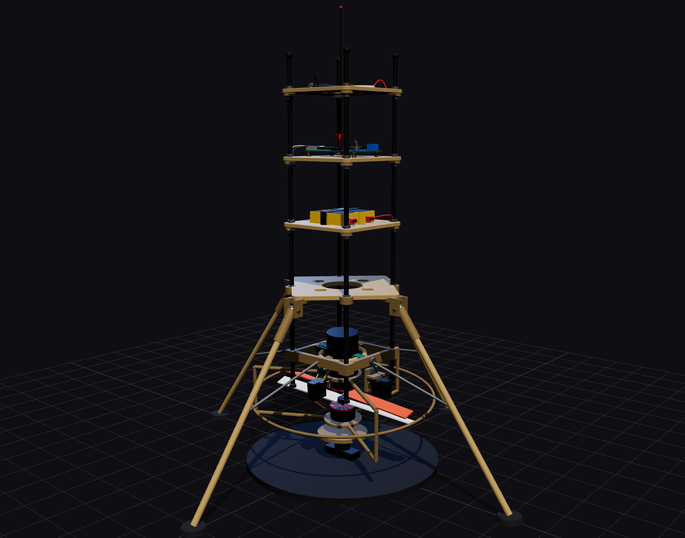

# Test stand procedure (Gates B, C, D)

Read [safety](../safety.md) in full first. These tests spin real propellers at 8 000 to 12 000 rpm. Treat the stand as a hazard zone.

## 1. The stand

Model part `test-stand`: base plate, centre column with a load cell and a cradle plate under the motor cage. Baseline (decision D-11): a **fixed stand**: the vehicle is restrained on the plate and the thrust is read by the load cell while the gimbal moves freely. A fixed stand cannot test closed-loop attitude, so Gate D uses a **tilting rig** (§6).

| Requirement | How |
|---|---|
| Anchored | Plate bolted down or ballasted > 10× the thrust weight |
| Restraint | Two independent straps rated ≥ 3× the full thrust (≥ 80 N) from the rods to the plate; failure of one must not release the vehicle (RK-11). Keep them clear of the props and the gimbal motion |
| Thrust measurement | 20 kg load cell + HX711 at ≥ 80 Hz, calibrated with known weights the same day |
| Prop shield | Polycarbonate panel or net between the vehicle and every person, rated for a blade fragment; no one stands in the plane of the props |
| Clear zone | No loose objects, cables or dust within 3 m; wear eye protection |
| Safety line | ≥ 5 m behind the shield; the operator holds the radio with the arm switch |
| Power | 6S pack, fused, XT60 with a **removable arming loop** that the operator inserts last |

## 2. Roles

Test Director (calls everything) · Operator (radio, arm switch, throttle) · Data person (load cell, log, video) · Spotter (eyes on the vehicle and the zone). One person may not hold two of these roles.

## 3. Documents to have on site

- This procedure and the pre-test checklist, printed.
- The Gate A log (gimbal calibration and sign checks).
- The test log template ([phase 1 template](../phase1-monocopter/06-bench-tests.md) works).
- Emergency numbers and the site address.

## 4. Gate B: static thrust with the gimbal **locked** at centre

Purpose: validate the stand, the thrust measurement, the motors, ESCs, props and the structure under thrust. **No control, gimbal clamped.**

**Pre-test checklist** (read aloud, answer "check"):

1. ☐ Weather and site: indoors or sheltered, wind ≤ 15 km/h, nothing flammable near the stand.
2. ☐ Props inspected (no nicks or cracks), balanced, tight, correct rotation (A clockwise, B counter-clockwise).
3. ☐ Vehicle: gimbal locked mechanically at centre; servo BEC unplugged; motor leads connected to the ESCs; arming loop **out**.
4. ☐ Software commit and gains recorded: ______ ; radio link verified, throttle stick at zero.
5. ☐ Load cell zeroed and calibrated; logging running.
6. ☐ Restraints and anchors inspected; shield in place.
7. ☐ Everyone not required has moved behind the safety line.
8. ☐ 6S pack inspected (voltage ≥ 24.0 V) and connected; fire extinguisher and LiPo bag at hand.
9. ☐ Everyone confirms "clear" **by name**. Director: "Arming in 5".

**Sequence:** insert the arming loop → radio arm switch on → ARMED (LED) → throttle steps 10 %, 20 %, 30 %, … up to 90 %, hold 5 s each, back to 0 → arm off → loop out.

**Abort immediately** for: unusual noise or vibration, a prop touching anything, smoke or smell, a restraint moving, a person entering the zone, battery below 3.3 V per cell. Abort = throttle zero, arm switch off, then loop out.

**Gate B pass criteria**

- ☐ Thrust at 90 % ≥ 2.2 × weight (≥ 23 N) and monotonic with throttle (RK-12)
- ☐ Current < ESC and battery limits; battery above 3.4 V per cell under full load
- ☐ Both motors give similar thrust (difference < 10 %); the **spin torque** with equal throttle is small
- ☐ Vibration: IMU noise (gyro σ) < 0.05 rad/s at hover throttle
- ☐ ESCs and motors warm, not hot (< 70 °C) after 60 s at hover throttle
- ☐ No loose or damaged hardware, restraints intact
- ☐ Data and video archived

## 5. Gate C: gimbal sweeps under thrust, open loop

Purpose: verify the gimbal, gears and servos under load, and measure the plant gain.

Additional prerequisites: Gate B passed; Gate A calibration re-checked.

Changes to the checklist: gimbal **unlocked**, servo BEC connected, a pre-programmed sweep (±3° then ±5° on each axis, 0.5 Hz) at **hover throttle (≈ 60 %)**, closed loop **off**.

**Pass criteria:** the gimbal tracks the script within 1° under load; no servo stall or brown-out (servo BEC voltage ≥ 6.8 V, no Teensy reset); no skipped gear teeth afterwards; the measured side force vs commanded angle matches `T sin δ` within 25 % (lateral load cell or video + IMU); the measured `G` goes into the PID lab.

## 6. Gate D: closed loop on a tilting rig

A fixed stand cannot respond to attitude. Use a **pivoting rig**: the vehicle sits on a single low-friction pivot (ball joint or a gimbal bearing) near its CG so that it can pitch and yaw ±20° but cannot leave the rig, with a travel limiter and a restraining line. Build and test the rig **with the props off** first (hand-tilt it and check that the controller reacts as in the sign test).

Procedure: as Gate B, with closed loop enabled and a commanded attitude offset of 2° applied after the vehicle reaches hover throttle (software step). The Director stays beside the operator with the shield between them and the rig.

**Pass criteria (RK-13):** the offset is rejected within 0.5 s; gimbal saturation (±6.5°) is below 20 % of the run; no divergence; the log matches the PID lab (natural frequency within 30 %). Spin about the vertical axis stays within ±30°/s with the yaw stick centred.

## 7. Dry run (mandatory before the first live run of each gate)

Run the **entire** procedure with the props off: roles, calls, checklist, radio, abort calls, extinguisher access, logging. Time it. Fix every confusion in this document and record who attended.

## 8. Abort criteria (any person may call, immediately obeyed)

Before powering: anyone enters the zone; weather outside limits; any restraint or stand anomaly; smell, leak, swollen battery; radio or software fault; unclear communication.

During a run: structural failure; unexpected motion; abnormal noise or vibration; smoke; prop contact; tilt > 35° on the rig; loss of data; link loss (the vehicle cuts the motors by itself).

On abort: throttle zero, arm off, wait for the props to stop, loop out. **Do not approach until the props have stopped.** Battery fire: extinguisher, only from a safe distance and only if trained.

## 9. After-test routine

1. Make the vehicle safe: arming loop out, RBF pin in, pack disconnected.
2. Cool-down, then inspect (props, motors, ESCs, bolts, gears, cables, restraints).
3. Save logs, photos and video; fill the test log; update gains, `G`, hover throttle in the PID lab and the sizing page.
4. Debrief: what went wrong or nearly did; update this procedure.

## 10. Gate summary

| Gate | Needs | Output |
|---|---|---|
| A | Bench, props off | Calibrated gimbal ([05](05-gimbal-design.md)) |
| B | Fixed stand, props on, gimbal locked | Stand, thrust and power validated |
| C | Fixed stand, open-loop sweeps | Gimbal under thrust, measured `G` |
| D | Tilting rig, closed loop | Control validated |
| E | [Flight test plan](08-flight-test-plan.md) | First free flight |
